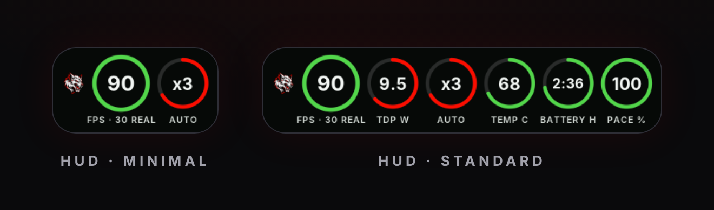
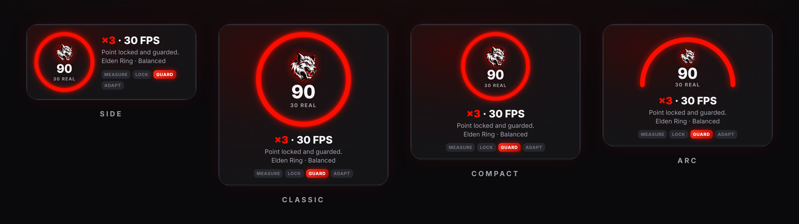

<div align="center">

**English** · [Русский](README.ru.md)


# GFG EXTREME 3.1

**MOST POWERFUL DECKY PLUGIN EVER.**

Compositor-Native Frame Generation · Intelligent APU Control · Gamescope Integration

[**Download latest**](https://github.com/wavessevaw/GFG-Extreme/releases/latest) · [Install](#installation) · [Kedavra](#02--gsf-kedavra) · [Autopilot](#04--gfg-autopilot) · [Modes](#06--performance-modes) · [HUD](#08--observability)

[](https://github.com/wavessevaw/GFG-Extreme/releases/latest)
[](https://github.com/wavessevaw/GFG-Extreme/releases)
[](#installation)
[](https://github.com/SteamDeckHomebrew/decky-loader)
[](https://github.com/wavessevaw/GSF_Kedavra)
[](#02--gsf-kedavra)
[](LICENSE.md)
[](https://t.me/gfg_extreme)


<sub>Real GFG Extreme 3.0.0 interface rendered in a browser with illustrative sample data. Not measured game performance.</sub>


<table>
<tr>
<td width="33%" align="center"><b>GSF KEDAVRA</b><br><sub>Own frame generation inside Gamescope. Auto, ×2, ×3, ×3.75, Custom. SDR and HDR.</sub></td>
<td width="33%" align="center"><b>AUTOPILOT</b><br><sub>Measure, lock, guard, adapt. The lowest TDP that holds the frame rate.</sub></td>
<td width="33%" align="center"><b>ONE ZIP</b><br><sub>Installed from Decky. Installs its own Gamescope, rolls back by itself.</sub></td>
</tr>
</table>

</div>

---

## FRAME GENERATION HAS MOVED INTO THE COMPOSITOR.

### A FUNDAMENTAL SHIFT IN STEAM DECK PERFORMANCE.

GFG Extreme 3 combines its own frame generation engine, GSF Kedavra, with the GFG Autopilot / Governor performance control system.

Frame generation, frame presentation and power optimisation are now treated as connected parts of one graphics pipeline.

Kedavra runs GPU motion estimation and reconstructs in-between frames directly inside Gamescope. GFG analyses the game's performance, the compute cost of generation and the Steam Deck's available power budget.

No Lossless Scaling, no MAKO, no third-party frame generation layers: the whole frame pipeline runs inside GFG's own Gamescope.

Version 3.0 is built on three technologies:

**FRAME RECONSTRUCTION**
Its own Vulkan Compute pipeline for motion estimation and in-between frame synthesis.

**PRESENTATION CONTROL**
Compositor-level frame scheduling that follows the display refresh and GPU readiness.

**INTELLIGENT POWER MANAGEMENT**
A closed TDP control loop with feedback that verifies every decision it makes.

**ONE ENGINE. ONE CONTROL PLANE. ONE PERFORMANCE TARGET.**

---

## Installation

1. Download the latest **GFG-Extreme-v3_x_x.zip** from [Releases](https://github.com/wavessevaw/GFG-Extreme/releases/latest).
2. In Decky Loader: **Settings → Developer → Install Plugin from ZIP**, pick the file.
3. Open GFG Extreme. The panel opens on one screen: **Install engine**, then **Reboot now**. The tabs unlock once the Kedavra Gamescope runs.
4. Start a game and choose a mode on **Dash**. Nothing else to set up: no launch options, no Desktop Mode scripts.

Coming from 2.x: settings move over with a backup, and MAKO is removed and the system restored automatically.

> Not every game and SteamOS build has been checked on a Deck yet; reports are welcome in [Issues](https://github.com/wavessevaw/GFG-Extreme/issues/new/choose) or the [Telegram channel](https://t.me/gfg_extreme). If Gaming Mode does not come back with the Kedavra Gamescope, the stock compositor is restored on the next boot.

---

## 01 / GENERATION PHILOSOPHY

### MORE GENERATED FRAMES ISN'T ALWAYS BETTER.

### WHY WE DELIBERATELY STOP AT ×4.

The highest multiplier is not a measure of a good frame generator.

As the multiplier grows, more of what you see is synthetic, motion reconstruction gets harder, and responsiveness depends more and more on the game's real frame rate.

You can reach a high Output FPS with too low a Real FPS. The numbers then grow faster than the actual quality of play.

GSF Kedavra has an architectural limit of ×4: at most three generated frames per real one.

In practice the floor is stricter. By default no mode goes past ×3 (30 FPS at 90 Hz): above that the picture and the latency suffer. **Setup → Allow above ×3** unlocks ×3.75 (24 FPS at 90 Hz) for Battery, a low battery and the Dash choice. Custom accepts any base frame rate from 20 FPS, but never deeper than ×4.

Multipliers don't have to be whole numbers. Kedavra caps the game at a base frame rate and generation fills every display refresh, so at 90 Hz 40 FPS gives ×2.25, 35 FPS gives ×2.6 and 24 FPS gives ×3.75.

**Engineering priorities**

* **Original FPS first.** Keep enough real game frames.
* **Bounded latency.** Control the extra delay of the interpolation pipeline.
* **Consistent pacing.** Minimise repeats and missed intervals.
* **GPU budget awareness.** Account for the generator's compute cost.
* **Performance per watt.** Use less power without losing useful performance.

**WE DON'T MAXIMIZE THE MULTIPLIER.**
**WE MAXIMIZE THE USEFUL RESULT.**

---

## 02 / GSF KEDAVRA

### COMPOSITOR-NATIVE FRAME GENERATION.

GSF Kedavra is GFG Extreme's own graphics engine, built directly into Gamescope.

It captures the original frames, estimates motion at several resolutions, reconstructs in-between frames and controls when they are presented.

**Processing pipeline**

```
                    GAME RENDERING
                          │
              Base FPS cap (Kedavra limiter)
                          │
                          ▼
                   ORIGINAL FRAMES
                          │
          ┌────────── GAMESCOPE ──────────┐
          │                               │
          │          GSF KEDAVRA          │
          │                               │
          │     Frame History (ring)      │
          │              ↓                │
          │   Luma Pyramid (4 levels)     │
          │              ↓                │
          │   Multi-Resolution Motion     │
          │   Estimation (bidirectional)  │
          │              ↓                │
          │  Scene-Cut & Camera Motion    │
          │              ↓                │
          │     VBlank-Aware Scheduler    │
          │  (real / generated / repeat)  │
          │              ↓                │
          │    Temporal Reconstruction    │
          │   (motion-compensated warp)   │
          │              ↓                │
          │   Post Filters (after FG)     │
          │              ↓                │
          │  Frame Composition + HUD      │
          │                               │
          └──────────────┬────────────────┘
                         │
                         ▼
                      DRM / KMS
                         │
                         ▼
                       DISPLAY
```

Motion is analysed once per real frame, in its own GPU submission after the composite. On every display refresh the scheduler decides what to show: a real frame, a generated one or, if the data is not ready, a repeat. Only then is the in-between frame it needs reconstructed.

**Engine capabilities**

| Component | Implementation |
|---|---|
| Graphics API | Vulkan |
| Processing | GPU Compute Shaders |
| Motion Estimation | Multi-resolution, bidirectional, with temporal seeding |
| Frame Reconstruction | Motion-compensated interpolation |
| Multipliers | Auto / ×2 / ×3 / ×3.75 / Custom base FPS (fractional, up to ×4) |
| Automatic Mode | Base FPS chosen from the game's measured frame rate |
| Source FPS Control | Kedavra base FPS cap inside Gamescope (Steam's limiter is not used) |
| Frame Scheduling | VBlank-aware |
| Color | SDR (8/10-bit) and HDR: HDR10 PQ and scRGB in float frames |
| Diagnostics | KMS flip tracing (Pace capture) |
| Target Hardware | Steam Deck OLED (90 Hz); Steam Deck LCD and docked 60 Hz |

**Target operating points**

| Display | Original FPS | Multiplier | Output |
|---|---|---|---|
| 90 Hz | 45 | ×2 | 90 FPS |
| 90 Hz | 40 | ×2.25 | 90 FPS |
| 90 Hz | 35 | ×2.6 | 90 FPS |
| 90 Hz | 30 | ×3 | 90 FPS |
| 90 Hz | 24 | ×3.75 | 90 FPS |
| 60 Hz | 30 | ×2 | 60 FPS |
| 60 Hz | 25 | ×2.4 | 60 FPS |
| 60 Hz | 20 | ×3 | 60 FPS |

With a whole multiplier (×2, ×3) every pair of real frames gets the same number of in-between frames: one at ×2, two at ×3 (at 1/3 and 2/3 of the interval). With a fractional multiplier real frames arrive every 2 and 3 (or 3 and 4) refreshes, and generation fills every refresh in between.

Kedavra can also pick the game's base frame rate automatically (Auto). The operating point it picks depends on how many original frames the game delivers and how steady they are.

These are target modes. The real Output FPS depends on the game's performance, the GPU time available and whether every composite meets its deadline.

---

### BOOST 2.0 (EXPERIMENTAL)

The second generation of Boost, rebuilt for Kedavra. Generated frames smear exactly where the camera turns, so for a turn of about a second with the right stick GFG lowers the multiplier to ×1.75 (a sharp turn: ×1.5, set in Setup) and gives it back as soon as the stick rests, at most 1.5 s per turn. A thread reads the Deck's controller (or a pad in the dock) and talks to the engine directly, without waiting for the 1 s control loop. Watts are never raised: the boost only uses what the GPU can render at the present TDP, so it shows most in Quality and with a fixed ×3. Off by default: **Setup → Experimental → Boost 2.0**.

---

## 03 / PRESENTATION-LEVEL CONTROL

### FRAME GENERATION IS ONLY HALF THE PROBLEM.

An in-between frame that sits in GPU memory is not enough. It has to reach the display at exactly the right moment.

At 90 Hz the display refreshes every 11.111 ms.

Kedavra uses a scheduler tied to Gamescope's refresh cycle to coordinate real and generated frames.

**VBlank-aware scheduling**

The scheduler accounts for:

* when original frames arrive;
* when GPU work is ready;
* the time position of each generated frame;
* the current display refresh rate;
* missed slots;
* repeated presentations;
* changes of the source frame rate;
* scene cuts (frames are never blended across a cut);
* recovery after long gaps in the frame stream.

**GPU execution & synchronization**

In-between frames are made in a Vulkan Compute pipeline built into the composite.

Running there lets generation line up with Gamescope's own graphics work and keeps the cost of the extra passes under control. If motion analysis keeps falling behind, generation pauses and then retries instead of breaking the rhythm.

**KMS-level diagnostics**

Tracing of presentation events gives the data to analyse frame pacing, misses and how the scheduler behaves under load.

The goal is steady presentation of useful frames with the smallest extra delay needed.

Interpolation needs the next real frame, so the picture is shown about one source frame later, plus analysis time. End-to-end latency also depends on the game's real frame rate and the display, so it is measured separately on hardware.

**GENERATE. SCHEDULE. PRESENT.**
**EVERY FRAME HAS A DEADLINE.**

---

## 04 / GFG AUTOPILOT

### CLOSED-LOOP PERFORMANCE OPTIMIZATION.

GSF Kedavra runs the frame pipeline.

GFG Autopilot runs the performance of the system that carries it.

CPU, GPU, the game, compute shaders and the compositor all share the Steam Deck's power budget.

The best operating point depends on the actual load, the cost of generation and the power available.

GFG Autopilot unites Kedavra's Auto with GFG Extreme's Autopilot. It picks the operating point (base frame rate and multiplier) and coordinates with GFG Governor, which controls TDP.

**Control loop**

```
              GAME + GSF KEDAVRA
                       │
                       ▼
                UNIFIED TELEMETRY
  Real FPS / Pacing / GPU time / CPU & GPU load
           Power / Temp / Clocks
                       │
                       ▼
                 GFG AUTOPILOT
             Operating Point Selection
                       │
                       ▼
                  GFG GOVERNOR
               TDP Optimization
                       │
                       ▼
                 STEAM DECK APU
                       │
                       └──── Feedback
```

**Operating principles**

**MEASURE** — At full TDP: which frame rate does the game hold steadily?
**LOCK** — Lock a stable operating point (base frame rate + multiplier).
**GUARD** — Protect the point: Governor lowers TDP while the point holds and gives power back at the first sign of a drop.
**ADAPT** — If the point fails even at full power, step down; later, carefully try the step above.
**STABILIZE** — Keep the efficient point and avoid needless changes.

Governor aims for the smallest power budget that keeps both the game and the generator steady.

**Splitting the power between CPU and GPU**

GFG measures the load of the busiest CPU core, GPU utilisation and the GPU clock every second, and uses them on a locked point:

- **Power Split** (GPU-bound game): CPU and GPU share one power limit, so GFG lowers the CPU's maximum clock step by step (100 / 85 / 70 / 60 / 50 %, never under 1.6 GHz) and gives those watts to the GPU. Every step is proven with A/B/A windows; the cap is lifted at once when real frames dip or the busiest core nears its limit.
- **GPU clock ceiling** (CPU-bound game): when the CPU is the limit and the GPU is lightly loaded, GFG lowers the GPU clock in 100 MHz steps through SteamOS's own GPU clock control (the Quick Access Menu slider) and keeps a step only if the frame rate holds and APU draw drops.

Both act only on a locked point with Governor settled, one at a time, and every change restarts the measurement windows. The player's own CPU limits and manual GPU clock are always restored and never overridden.

Lower power that costs real FPS, pacing or generation stability does not count as a successful optimisation.

**EFFICIENCY WITHOUT SACRIFICING FRAME STABILITY.**

---

## 05 / UNIFIED CONTROL ARCHITECTURE

### TWO INTELLIGENT SYSTEMS. ONE CONTROL PLANE.

GFG Extreme and Kedavra each run their own specialised control logic.

Their responsibilities are split at the system level.

| GSF Kedavra | GFG Extreme |
|---|---|
| Source FPS limiting | Operating point selection (Autopilot) |
| Generation multiplier | TDP optimization (Governor) |
| Motion estimation | Performance analysis |
| Frame reconstruction | APU power, temperature, CPU & GPU load telemetry |
| Presentation scheduling | Power Split (CPU clock) & GPU clock ceiling |
| | Thermal protection |
| GPU generation diagnostics | Operating-point history per game |
| Post filters & HUD layer | Filter, HUD and profile settings |

Kedavra owns the FPS limiter and the frame generation itself.

GFG hands the engine one agreed policy (multiplier, base frame rate, filters) and counts it as applied only once the engine confirms it. GFG controls the system's power policy (TDP, the CPU clock cap and the GPU clock ceiling).

When the base frame rate or the multiplier changes, Governor gets a new operating point. Power tests never mix measurements from incompatible states.

If another tool (for example the standalone GSF Kedavra plugin) changes the same settings, GFG does not fight it: it backs off and offers to take over.

**ONE OWNER PER CONTROL. ONE CONSISTENT SYSTEM STATE.**

---

## 06 / PERFORMANCE MODES

### EXPLICIT PRIORITIES. ADAPTIVE EXECUTION.

<p align="center"></p>

GFG Extreme offers four performance strategies.

| Mode | Optimization objective |
|---|---|
| Autopilot | One adaptive mode: never above 15 W, keeps base 35-40 when the game holds it, ×3 at least, ×3.75 only when ×3 needs all 15 W or the battery is low |
| Battery | Efficiency first: ×3.75 at 90 Hz (×3 at 60 Hz) and the lowest TDP that holds it |
| Balanced | The highest base frame rate the game holds, without needless changes; never below x3 |
| Quality | Real frames and motion quality first; never below x2.5 |

The strategy sets the optimisation goals.

Kedavra carries out the agreed frame generation policy, and Governor weighs the available power budget.

The same Output FPS can come from different pairs of real frame rate and multiplier; the choice weighs their real cost and quality.

Every game is remembered: the point it held, its class and the medians of its last sessions. A known game starts on its point, without measuring at full power again.

* **Light games** (DuckTales, Terraria, Hades, Celeste and other titles on the built-in list, or measured as light on your Deck): 4-7 W and never above ×2 in Balanced, Quality and Autopilot.
* **Heavy games** (The Witcher 3, Elden Ring, Cyberpunk 2077, Death Stranding and others): the session starts at 15 W.
* **Dock (TV)**: an external gamepad needs low latency, so no mode goes above ×3 there. A higher TDP is fine on the TV; the temperature is still watched.
* **Steam Deck LCD**: 60 Hz, or the panel's own rate when it is unlocked (for example 75 Hz).

### WE CARE ABOUT YOUR STEAM DECK'S HEALTH.

SteamOS lets the APU run at 85-89 °C for hours. We don't agree with that, and we want your Deck to last.
GFG Extreme deliberately holds games back from 80 °C, in every mode:

| APU temperature | What GFG Extreme does |
|---|---|
| 80 °C | No mode climbs to a more demanding point: no extra watts for extra frames |
| 85 °C | The TDP ceiling comes down a watt at a time until the Deck cools to 80 °C |
| 97 °C | The TDP drops to the minimum at once |

Every mode also stays at or below 15 W, even when SteamOS allows 20 W.

---

## 07 / IMAGE PROCESSING

### A UNIFIED VISUAL PIPELINE.

GFG Extreme keeps its graphics filters, now moved inside Gamescope. No vkBasalt needed.

Filters run after generation, on the frame that goes to the screen. Motion analysis never sees filtered pixels, so grain and sharpening never fake motion. Real and generated frames get exactly the same look, and the HUD and Steam's overlays stay unfiltered.

**Color & Tone**
HDR Look · Vibrance · Colourfulness · Curves · Technicolor · Technicolor 2 · DPX · Levels Plus

**Sharpness & Anti-Aliasing**
CAS · DLS · Clarity · FXAA · SMAA

**Creative Processing**
Film Grain · Vignette · Chromatic Aberration · Deband · Noir · Sepia · Monochrome · Bleach Bypass · Cartoon · Nostalgia

Presets: Sharp · Vivid · HDR Look · Cinema · Noir · Retro · Smooth.

The order of passes is fixed: colour and tone → sharpening → antialiasing → finish (vignette, grain, chromatic aberration).

Filters work on encoded pixel values (sRGB), as in ReShade and vkBasalt. There is no double sRGB decode.

**HDR.** Frame generation supports HDR games (HDR10 PQ and scRGB). Colour filters are SDR art effects and are not applied to HDR frames. On HDR10, sharpening, antialiasing and finish effects still apply; scRGB frames are shown unfiltered. HDR Look is an SDR filter with an "HDR" style, not an HDR output mode.

---

## 08 / OBSERVABILITY

### MEASURE THE PIPELINE. NOT JUST THE FPS.

<p align="center"></p>

GFG Extreme's unified telemetry covers original rendering, generation, frame presentation and hardware.

| Metric | Description |
|---|---|
| Real FPS | The game's original performance |
| Output FPS | New frames on screen (real + generated) |
| Effective Multiplier | Current generation mode |
| Pace | Share of display refreshes without a repeat |
| KMS Flip Events | Recorded presentation events |
| GPU Generation Time | Compute cost of the generator and the filters |
| APU Power Draw | Actual APU power use |
| TDP Limit | Power budget in force |
| APU Temperature | Temperature and thermal headroom |
| CPU / GPU Load | Busiest CPU core, GPU utilisation and GPU clock |
| CPU Clock Cap / GPU Clock Ceiling | What Power Split and the GPU ceiling currently allow |
| Autopilot State | Control loop phase (measure, lock, guard, adapt) |

The system tells internal generation events apart from presentations confirmed by the display.

Diagnostic traces show missed frames, transitions between operating points, GPU overload and how well TDP changes worked.

Hardware test results can be reproduced and matched against the control system's decisions.

**REAL METRICS. REPRODUCIBLE RESULTS.**

---

## 09 / NATIVE STEAMOS INTEGRATION

### ONE ENGINE. ONE INTERFACE.

<p align="center"></p>

GFG Extreme 3 is one system for frame generation and performance control, run from Decky Loader. One zip, installed from Decky, no Desktop Mode scripts.

Kedavra lives inside Gamescope, so in the stock Gaming Mode no game needs its own launch command for generation.

**Core capabilities**

* Compositor-native frame generation, SDR and HDR.
* Kedavra Off / Auto / ×2 / ×3 / ×3.75 / Custom base FPS.
* GFG Governor & Autopilot.
* Adaptive TDP management.
* Per-game profiles.
* Graphics filters & image enhancement after generation.
* Unified performance HUD (drawn by Gamescope, after generation).
* GPU and APU telemetry.
* Session diagnostics and Pace capture.
* Controlled Gamescope installation, automatic rollback and recovery.
* Settings migration from GFG Extreme 2.x (with a backup).

Target platform: Steam Deck OLED / SteamOS.

It needs Gamescope with Kedavra, which the plugin installs itself. Installation checks the system, and a boot that the Kedavra Gamescope does not confirm is rolled back to the stock compositor automatically.

---

## 10 / ENGINEERING INDEPENDENCE

### OUR ENGINE. OUR FRAME PIPELINE. OUR ROADMAP.

GFG Extreme 3 runs on its own frame generation core, GSF Kedavra.

Motion estimation, image reconstruction and the scheduling of generated frames are developed in one GFG / GSF code base.

That keeps the generator's direction independent and lets it be tuned directly for Gamescope, Vulkan and GFG's control logic.

**Technology stack**

| Subsystem | Technology |
|---|---|
| Frame Generation | GSF Kedavra |
| GPU Processing | Vulkan Compute |
| Motion Estimation | Multi-resolution |
| Frame Reconstruction | Motion-compensated |
| Scheduling | Gamescope / Kedavra |
| Presentation | DRM / KMS |
| Power Management | GFG Governor (TDP), Power Split, GPU clock ceiling |
| Intelligent Control | GFG Autopilot |
| Interface | Decky Loader |

The core technologies stay part of the open Linux graphics stack.

The generator, the control of its compute cost and its link to frame presentation are brought together in one project.

**A NEW ENGINE.**
**A NEW PRESENTATION MODEL.**
**A NEW FOUNDATION FOR GFG EXTREME.**

---

## GFG EXTREME 3.0.0

### THE COMPOSITOR-NATIVE GENERATION RELEASE.

The biggest architectural update of GFG Extreme brings together GSF Kedavra frame generation, presentation control inside Gamescope and intelligent APU optimisation.

Version 3.0.0 is one platform for the further development of GPU reconstruction, frame scheduling and power management on the Steam Deck.

**NATIVE FRAME GENERATION.**
**PRESENTATION-LEVEL CONTROL.**
**INTELLIGENT POWER MANAGEMENT.**
**POWERED BY GSF KEDAVRA.**
**ENGINEERED FOR STEAM DECK.**

---

## Development & Validation

Version 3.0.0 is judged by measurable results:

* Original FPS stability.
* Presentation interval P95/P99.
* Frame generation GPU cost.
* Missed presentation deadlines.
* End-to-end latency.
* APU power consumption.
* Image reconstruction quality (SDR and HDR).
* Long-session stability.

Targets and real benchmarks of the 3.0.0 build (×3.75 and HDR included) are published after testing on real hardware.

---

## Project

* Repository: https://github.com/wavessevaw/GFG-Extreme
* GSF Kedavra: https://github.com/wavessevaw/GSF_Kedavra
* Community: https://t.me/gfg_extreme
* Platform: Steam Deck / SteamOS
* License: GPL-3.0-or-later, respecting the licences of the components used

This README describes GFG Extreme 3.1. Features become part of a confirmed release only after testing on real hardware.

---

<div align="center">


<sub>GFG EXTREME 3.1 · POWERED BY GSF KEDAVRA · Made for Steam Deck · GPL-3.0-or-later</sub>

</div>
