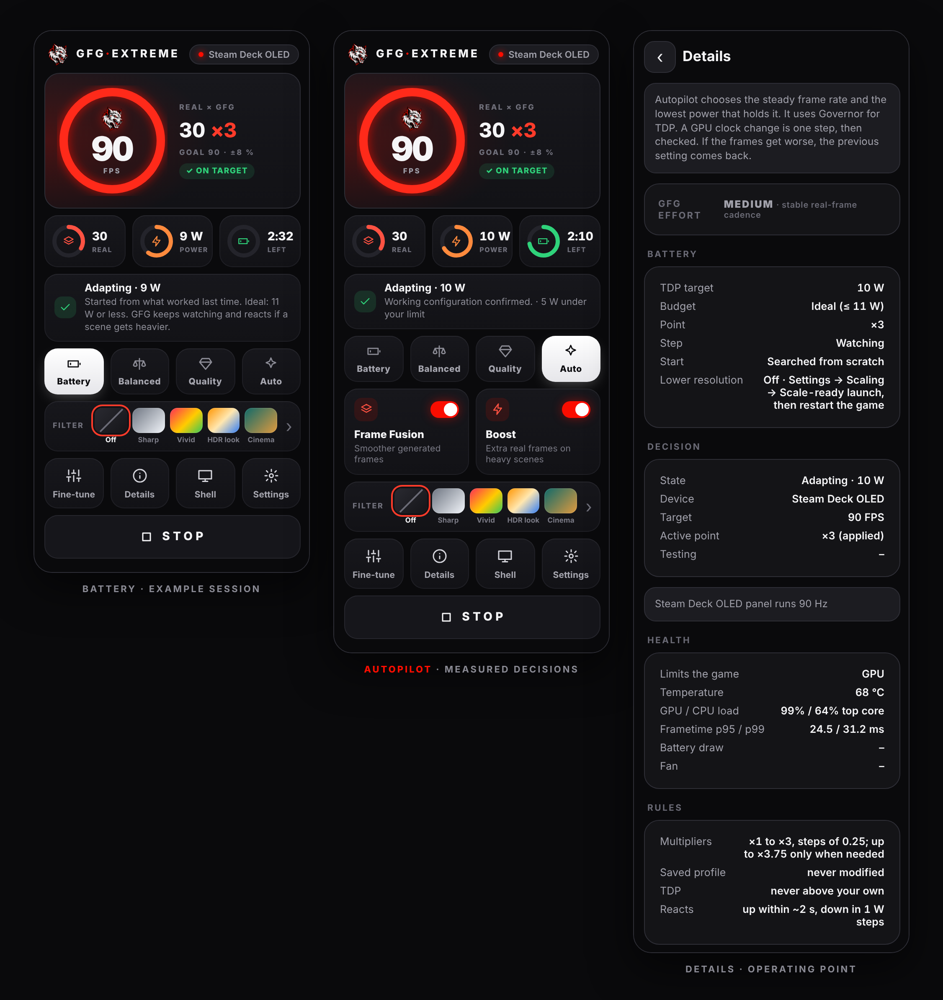
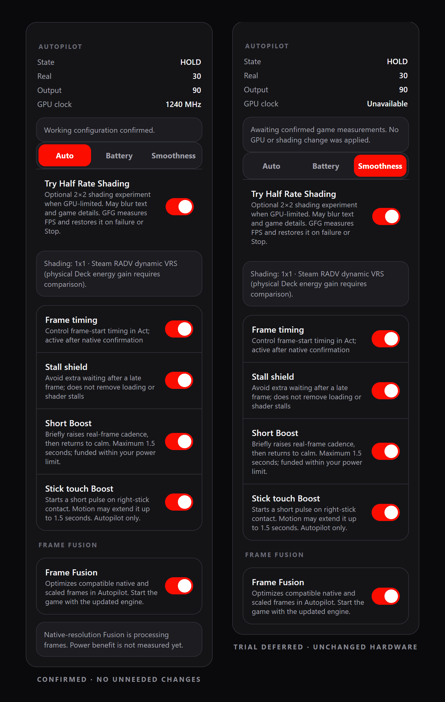
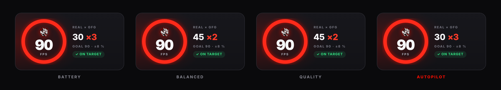
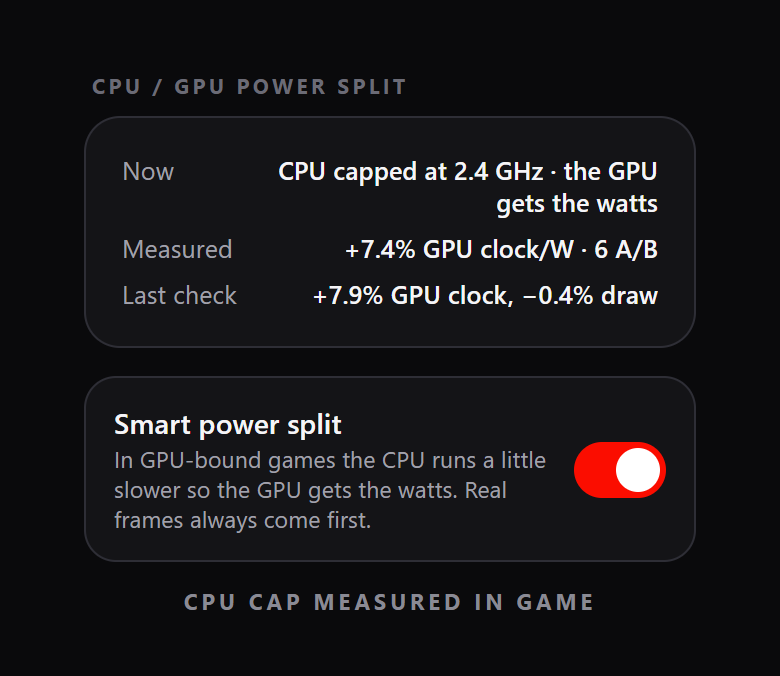
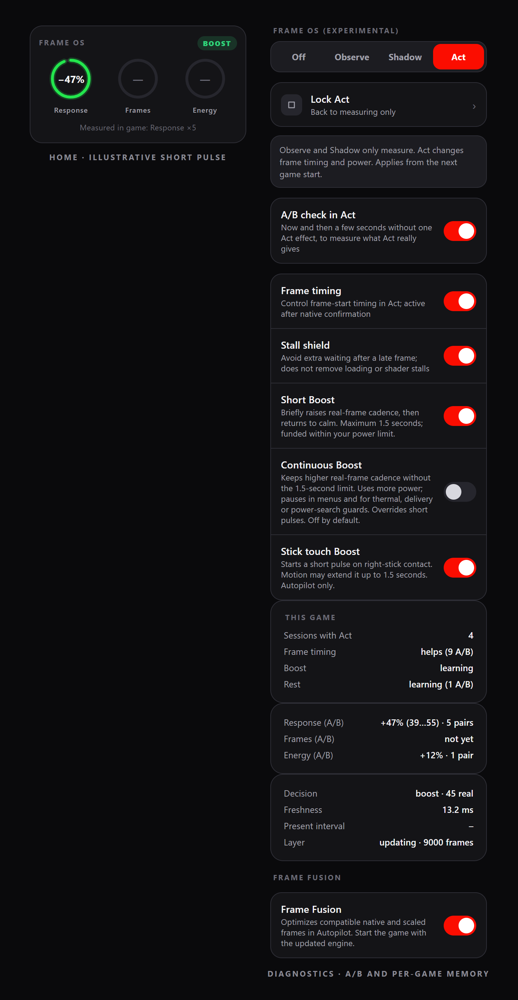
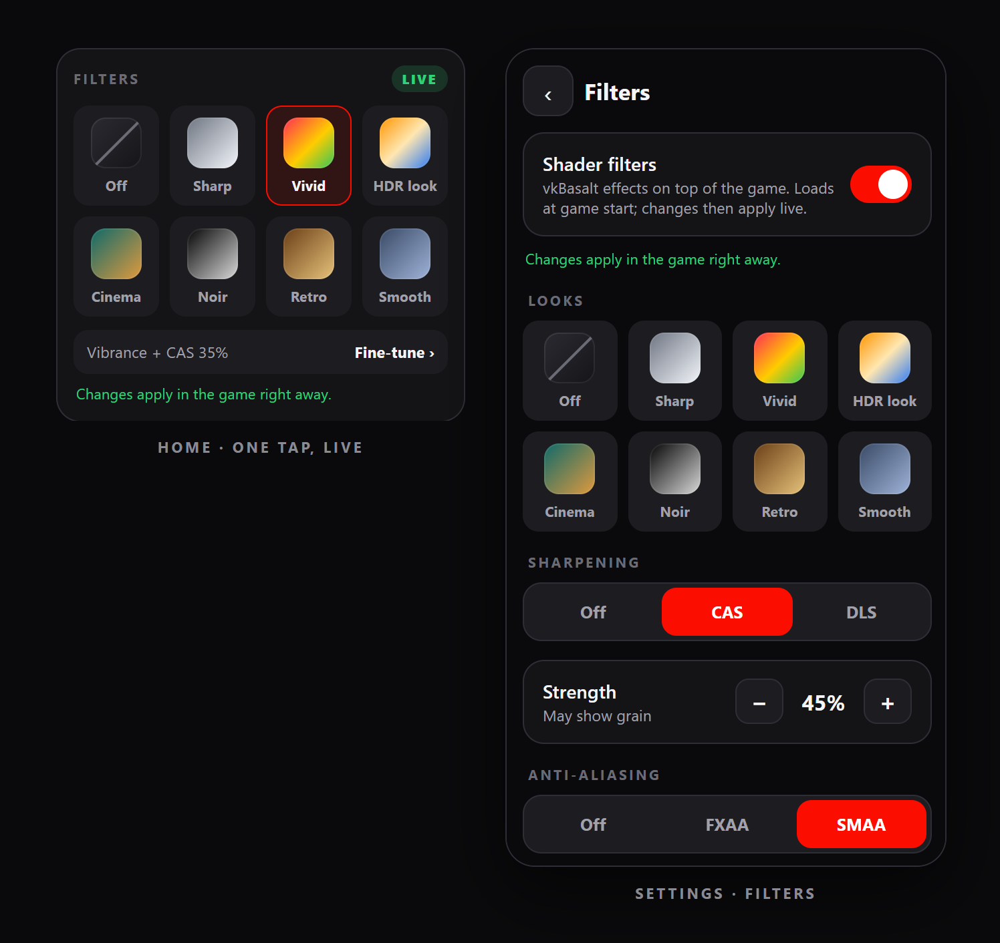
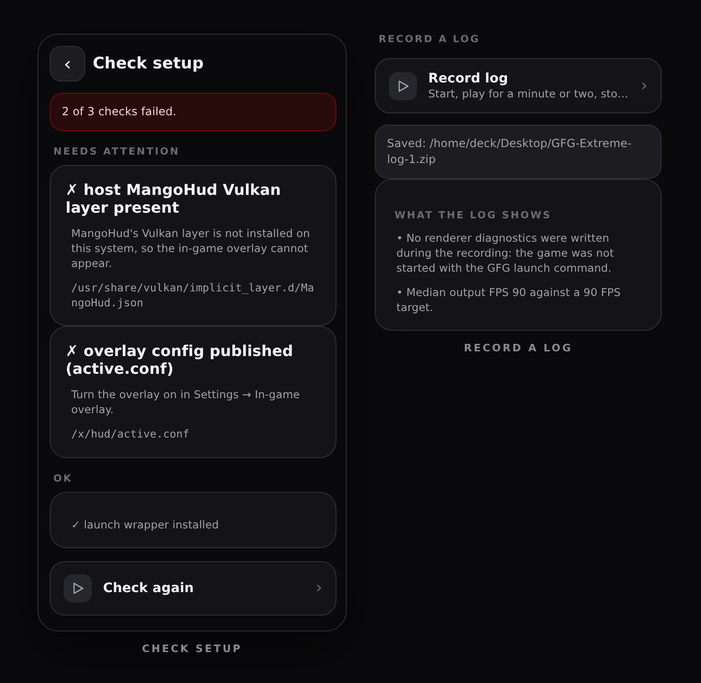
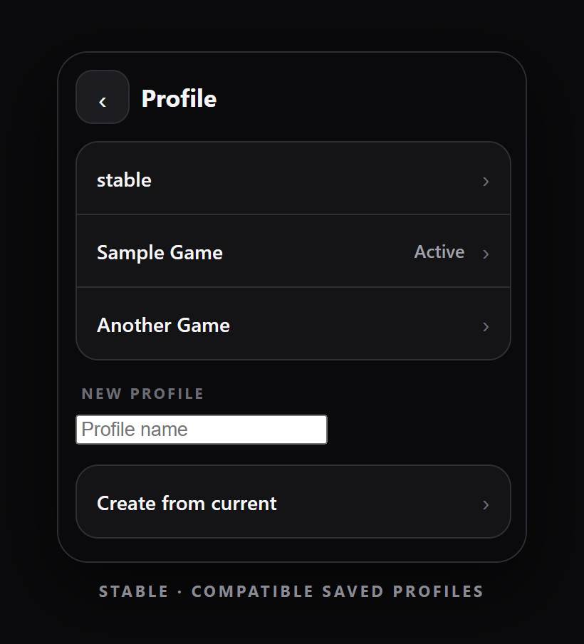

<div align="center">

[English](README.md) · **Русский**


# GFG Extreme

**Автоматическое управление кадрами, производительностью и энергопотреблением Steam Deck**

Плагин Decky Loader, который согласует работу генератора кадров, GPU и CPU, настройки графического конвейера и лимиты мощности. Autopilot анализирует телеметрию игры и выбирает действия, которые можно проверить по реальным измерениям.

[**Скачать 2.1.6**](https://github.com/wavessevaw/GFG-Extreme/releases/tag/v2.1.6) · [Установка](#установка) · [Autopilot](#autopilot) · [Диагностика](#диагностика)




<sub>Настоящий интерфейс GFG Extreme 2.1.2, отрисованный с демонстрационными данными. Это не результаты теста производительности.</sub>

</div>

## Autopilot

**Autopilot в GFG Extreme 2.1.6 — не автоматический ползунок TDP.** Это координационный режим, который пытается подобрать баланс между плавностью, количеством настоящих кадров, детализацией изображения, расходом энергии и температурой Steam Deck. Мощность здесь лишь один из инструментов.

Обычный Governor управляет отдельной рабочей точкой: сколько настоящих кадров нужно получить, сколько промежуточных создаст генератор и сколько ватт потребуется. **Autopilot находится над ним**: анализирует состояние игры, определяет, какой инструмент имеет смысл попробовать, временно передаёт ему управление и оценивает результат. Одновременно дёргать несколько регуляторов и пытаться понять, какой из них помог, — плохая идея, поэтому проверки разделены.

### Что именно умеет менять

| Инструмент | Задача | Как действует |
| --- | --- | --- |
| **Target FPS** | Выбрать достижимую цель, а не бесконечно преследовать недоступные 90 FPS | По свежим независимым интервалам Real/Output FPS может временно перейти с 90 на 60 и затем повторно проверить 90 |
| **Frame Generation** | Сбалансировать настоящие и сгенерированные кадры | Через Governor меняет рабочую точку и коэффициент генерации: от ×1 до ×3; ×3,25–×3,75 только при необходимости; ×4 — аварийная ступень, когда иначе не удержать вывод. Отклонение до 8 % от цели FPS считается попаданием в цель |
| **TDP / APU Power** | Сохранить кадры с меньшими затратами либо поддержать тяжёлую сцену | Подбирает лимит в ваттах, подтверждает его по FPS и потреблению, откатывает неудачные пробы |
| **GPU Clock** | Проверить, не мешает ли текущая политика частот при загрузке CPU | При вероятном CPU-ограничении пробует один шаг вниз по верхнему пределу частоты GPU через SteamOSManager и измеряет эффект |
| **CPU/GPU Power Split** | Перераспределить общий бюджет APU в пользу GPU | Отдельный модуль может ступенчато ограничивать максимум CPU, если процессор имеет запас и GPU действительно занят; Autopilot согласует такие пробы со своими блокировками |
| **Render Scale / Flow Scale** | Снизить вычислительную стоимость рендеринга или генерации | Governor может использовать подтверждённые ступени масштаба 90/80 % там, где движок их поддерживает; отдельный экспериментальный Flow-контроллер может проверять нагрузку генератора, когда не занят другой механизм |
| **Half Rate Shading** | Попробовать сократить стоимость шейдеров на GPU | При поддержке системой и включённом **Try Half Rate Shading**: испытывает Steam RADV VRS 2×2, проверяет результат и при неудаче возвращает исходное значение |
| **Температура и безопасность** | Не ухудшать состояние устройства ради сомнительных FPS | При перегреве, недостоверных датчиках или изменениях вручную удерживает либо прекращает эксперименты |
| **Телеметрия и HUD** | Объяснить, что происходит на самом деле | Отображает Real/Output FPS, загрузку CPU/GPU, GPU MHz, температуры, время кадра, TDP и состояние проверок |

Smart Power Split, Flow Scale, Frame OS Act и поддерживаемые пробы шейдинга включены по умолчанию. Autopilot согласует их работу и приостанавливает конфликтующие проверки. Сохранённое отключение функции остаётся в силе. Boost и Fusion выполняются только в Autopilot. Фильтры vkBasalt сохраняют выбранную конфигурацию.

### Как он принимает решения

1. **Наблюдение.** Собирает свежие Real FPS, Output FPS, p95/p99 времени *настоящего* кадра, фактическую частоту и загрузку GPU, самое загруженное ядро CPU, энергопотребление и температуру. Значение Output 90 не приравнивается к 90 настоящим или 90 оптически подтверждённым уникальным кадрам.
2. **Выбор цели и рабочей точки.** Учитывает частоту экрана и доступность рендерера, подбирает целевые реальные кадры, коэффициент генерации и энергетический бюджет. Если сцена усложнилась, Governor может сначала выбрать другую ступень генерации, а не только поднять ватты.
3. **Определение узкого места.** При высокой загрузке GPU рассматривает доступную мощность и, включённый Half Rate Shading. Когда CPU загружен, а GPU существенно свободен, возможна проба GPU Clock. Если оснований недостаточно, ничего не меняет.
4. **Один эксперимент.** Сохраняет исходную конфигурацию, меняет только один ресурс и ждёт свежих показаний. Во время проверки GPU Clock или VRS изменения TDP и пересекающиеся пробы временно блокируются.
5. **Подтверждение или откат.** Сравнивает новые независимые измерения с базовой точкой. Учитывает реальные и выходные FPS, p95 времени кадра, энергопотребление и нагрев. Неудачное изменение откатывает; неподтверждённое восстановление блокирует новые эксперименты.
6. **Адаптация дальше.** После периода стабильной игры может попробовать более экономичную рабочую точку или вернуть более высокую цель. Неудачные пробы помнит: например, после повторных провалов пониженного TDP задержка новой попытки достигает 30 минут.

### Пример работы

Допустим, Steam Deck OLED работает на 90 Гц. Игра уверенно выдаёт **30 Real FPS**, а генератор создаёт примерно **90 Output FPS** при коэффициенте **×3**. Autopilot видит достаточную стабильность и не обязан повышать потребление только потому, что видеочип загружен на 99 %. Он может удержать подтверждённую точку и проверить экономию позже.

В более тяжёлой сцене реальных кадров становится недостаточно. Governor может изменить коэффициент генерации или доступную мощность. **В предпочтении Auto цель 90 FPS не сбрасывается автоматически до 45 только из-за снижения Real FPS.** В явно выбранном предпочтении **Battery** возможен осознанный переход к **45 Output FPS** с последующей попыткой восстановления цели. Цель 60 FPS используется только на Deck LCD и на внешнем дисплее. После аварийного коэффициента выше ×3 Governor периодически пытается восстановить нормальную частоту настоящих кадров и откатывает неудачную пробу. Равномерность показа требует проверки на устройстве.

Если измерения указывают на GPU-ограничение, Autopilot вправе предложить шейдинг, если включён **Try Half Rate Shading**. Если узкое место неясно, правильным решением считается **HOLD**, а не случайная перестановка параметров.

*Числа выше иллюстрируют алгоритм, а не демонстрируют измеренный прирост автономности или производительности.*

### Предпочтения Autopilot

На главном экране GFG можно выбрать:

- **Auto** — ищет компромисс и не трогает стабильную конфигурацию без оснований для улучшения.
- **Battery** — сильнее ориентируется на экономию и допускает выбор более низкой целевой частоты при подтверждённой нехватке ресурсов.
- **Smoothness** — предпочитает устойчивый темп и более осторожно относится к экспериментам; Governor использует приоритет плавности.

Отдельный переключатель **Try Half Rate Shading** разрешает только эксперименты с VRS для текущего профиля. Он включён по умолчанию; сохранённое пользователем отключение сохраняется. Включение не означает, что VRS обязательно будет применён.

### Когда Autopilot намеренно ничего не делает

Режим не испытывает GPU Clock и VRS при открытом меню быстрого доступа Steam (QAM), на переходах между сценами, до подтверждения рабочей точки, при старых/недостаточных данных, перегреве, отсутствии поддерживаемого интерфейса или пока другая операция ждёт отката. Он учитывает ручные настройки игрока: менять их обратно поверх действий пользователя нельзя.

После **Stop**, закрытия игры или смены режима GFG пытается восстановить только те настройки, которыми владел сам. Статусы **HOLD**, **PAUSE**, **Testing**, **Rollback** и **Restore pending** отражают разные состояния; сообщение о *предложенной* пробе не доказывает, что запись в GPU/VRS реально произошла.

**Аппаратные ограничения:** программная реализация и автоматические тесты есть, но физическое управление GPU Clock и динамический Half Rate Shading на Steam Deck LCD/OLED ещё не подтверждены. Allow Tearing автоматически не переключается. Half Rate Shading влияет на шейдинг игры в целом, **а не выборочно на сгенерированные промежуточные кадры**, и может ухудшать читаемость изображения.

<div align="center">

<sub>Настоящий интерфейс Autopilot 2.1.2 с демонстрационными данными: нормальная работа и отложенная проба без изменения аппаратных настроек.</sub>
</div>


## Режимы

<div align="center"></div>

| Режим | Приоритет | Принцип |
| --- | --- | --- |
| **Battery** | Экономия | Сначала снижает TDP; множители до ×3; ×3,25–×3,75 только при необходимости |
| **Balanced** | Ровная картинка | Стартует примерно с 12 Вт; множители до ×3; ×3,25–×3,75 только при необходимости для сохранения вывода |
| **Quality** | Качество движения | Выбирает наименьший подходящий множитель из ступеней до ×3,75, затем ищет экономию |
| **Autopilot** | Управление всей системой | Координирует целевой FPS, генерацию, энергопотребление, GPU Clock, поддерживаемые графические пробы и независимые модули CPU/Flow |

Фактическая производительность зависит от игры, нагрузки, графического движка, экрана и ограничений мощности. Это стратегии управления, а не гарантированные минимальные FPS.

## Оверлей в игре

<div align="center">

<sub>Настоящий HUD GFG на условном фоне, с демонстрационными измерениями.</sub>
</div>

Оверлей Vulkan может показывать выходные и настоящие FPS, TDP, дополнительные параметры Autopilot и состояние Frame OS. Недоступные или устаревшие значения не отображаются как хорошие. Настройки вида, детализации и положения находятся в **Settings → In-game overlay**. Если кольца не могут загрузиться, предусмотрена текстовая строка.

## Другие возможности

- **Профили для игр**, запоминание подтверждённых настроек и сброс накопленных измерений.
- **Smart power split**: пробует ограничивать CPU только при стабильном TDP Governor и доказывает пользу сравнением A/B/A с сохранением Real FPS. Чужие ограничения частот не перезаписывает. [Критерии](docs/CPU_GPU_POWER_SPLIT.md).
- **Frame OS**: Observe, Shadow и Act; в Autopilot по умолчанию выбран Act. Эффективность Act не подтверждена для каждой игры; при нестабильности он должен отказаться от вмешательства.
- **Фильтры vkBasalt**: резкость, сглаживание и цветовые пресеты. Для первой загрузки некоторых слоёв нужен перезапуск игры.
- **История игровых сеансов**, журнал решений и экспорт диагностических логов.
- **GFG Shell 0.4** (по желанию): оболочка Gaming Mode для управления с геймпада на Godot, устанавливается и запускается из плагина. Игры по-прежнему запускает Steam. Показывает всю библиотеку Steam, включая купленные, но не установленные игры, а в быстрых настройках — кольца и переключатели GFG. Подробнее: [docs/GFG_SHELL.md](docs/GFG_SHELL.md).

<div align="center">



</div>

### Внешний генератор LSFG-VK 2.0

В меню **Generator Backend → LSFG-VK 2.0** можно выбрать установленный отдельно Vulkan-слой LSFG-VK 2.x. Для него нужен собственный лицензионный ресурс `lsfg-vk.dll` из установленной Lossless Scaling. GFG не содержит и не распространяет DLL, шейдеры или вычислительную модель LSFG.

Доступны множители 2×/3×, Flow Scale от 25% до 100%, режим Performance, FP16, FIFO, сохранение количества изображений swapchain и необязательный путь к DLL. Параметры применяются при следующем запуске игры через обычный GFG wrapper. При выборе LSFG-VK собственные FG и Output GFG для этой игры отключаются. Если внешний компонент не найден, запуск генератора блокируется, чтобы избежать ошибки Vulkan.

Наличие установленного слоя не гарантирует совместимость с каждой игрой Proton и Gamescope: аппаратная проверка этой интеграции на Steam Deck ещё не проведена.

## Установка

Нужны [Decky Loader](https://decky.xyz/) и [Lossless Scaling в Steam](https://store.steampowered.com/app/993090/Lossless_Scaling/) для поддерживаемой схемы генерации GFG.

1. Скачайте [**GFG-Extreme-v2_1_6.zip**](https://github.com/wavessevaw/GFG-Extreme/releases/download/v2.1.6/GFG-Extreme-v2_1_6.zip). В Decky выберите **Install from zip** и подтвердите необходимые разрешения на работу с управлением мощностью.
2. Откройте GFG Extreme, при необходимости нажмите **Install engine**.
3. В Steam зайдите в **Свойства игры → Параметры запуска** и добавьте:

   ```text
   /home/deck/.local/bin/gfg %command%
   ```

4. Перезапустите игру для загрузки движка и слоёв Vulkan, затем включите **Run**.

Для Heroic, Lutris, EmuDeck и других Flatpak-приложений проверьте интеграцию и разрешения в **Settings → System**. Новую сборку Decky можно установить поверх прежней; настройки профилей и история обучения сохраняются.

## Восстановление и безопасность

Governor использует временный runtime-overlay и не перезаписывает сохранённый профиль. Собственные изменения TDP, GPU Clock, Half Rate Shading и ограничителя CPU возвращаются при Stop, завершении игры и смене режима. Если возврат не подтверждён, повторные эксперименты блокируются до восстановления. Ручные действия игрока в Steam QAM имеют приоритет.

**Разгон, изменение BIOS и андервольтинг не требуются.** Если нужного интерфейса SteamOSManager нет, соответствующая функция Autopilot отключается.

## Диагностика

<div align="center"></div>

Откройте **Settings → Diagnostics → Check setup** для проверки рендерера, лаунчера, оверлея и доступа к мощности. Чтобы сообщить об ошибке, запустите **Record log**, воспроизведите её в игре и остановите запись. Прикрепите экспортированный ZIP к [GitHub Issue](https://github.com/wavessevaw/GFG-Extreme/issues). Укажите частоту экрана и было ли в момент ошибки открыто меню Steam.

## Статус и ограничения

**Версия ПО: 2.1.6.** Сохранены исправления Governor 2.1.5. Исправлены настройки включения Frame Fusion в нативном рендерере, взаимная блокировка экспериментов CPU/GPU Split и Governor, подтверждение применённого поколения настроек для A/B и независимые измерения мощности Rest. Аппаратным TDP по-прежнему единолично управляет Governor. Программные тесты не подтверждают аппаратный выигрыш FPS или задержки на Steam Deck. Динамические GPU Clock и Half Rate Shading ещё не проверены на LCD/OLED. Отдельной проверки требуют тайм-ауты доставки генерируемых кадров и реальная эффективность Frame OS Act. Allow Tearing автоматически не переключается.

Output FPS рендерера не равен независимому оптическому измерению показанных кадров. Переход 60/90 на OLED, читаемость изображения при VRS и надёжность восстановления нуждаются в игровых тестах до любых обещаний ускорения или экономии.

[Примечания к стабильному релизу](RELEASE_DESCRIPTION_V2_1_5.md) · [Известные ограничения](docs/GFG_GOVERNOR_KNOWN_LIMITATIONS.md) · [Проверки Autopilot](docs/AUTOPILOT_ACCEPTANCE.md)

<details>
<summary><b>Для разработчиков</b></summary>

```bash
npm ci
npm test
npm run screenshots       # перерисовать карточки реального интерфейса и HUD
python3 tools/gfg_log_report.py <log.zip>
```

Документация: [Governor](docs/GFG_GOVERNOR_ARCHITECTURE.md) · [Телеметрия](docs/GFG_TELEMETRY_CAPABILITIES.md) · [Frame OS](docs/GFG_FRAME_OS.md).

</details>

## Благодарности

GFG Extreme продолжает работу [MAKO](https://github.com/eugeniosegala/MAKO) и lsfg-vk. Проект наследует [Decky LSFG-VK Experimental](https://github.com/eugeniosegala/decky-lsfg-vk-experimental). Lossless Scaling в состав GFG не входит и не распространяется вместе с ним.

Сообщество: https://t.me/gfg_extreme

GPL-3.0-or-later · [Лицензия](LICENSE.md) · [Сторонние компоненты](THIRD_PARTY_NOTICES.md)

## Frame Fusion и кратковременный Boost

Стабильная 2.1.6 включает [Fusion Core и Native Fusion](docs/FRAME_FUSION.md), [кратковременный Boost и касание правого стика](docs/STICK_TOUCH_BOOST.md). **Boost и Fusion работают только в Autopilot.** Переключатели функций включены по умолчанию. Ранее сохранённое отключение сохраняется.

Fusion сокращает совместимые пересылки входа масштабирования и преобразование BGRA при родном разрешении. Предыдущие игровые логи показывали, что нативный Fusion оставался выключенным при запуске; в 2.1.6 исправлена запись параметра в TOML. Фактические передачи кадров, FPS и экономию нужно подтвердить новым логом Deck. При смене режима ускоренные пути немедленно закрываются.

При выключенном постоянном Boost касание правого стика запрашивает импульс **500 мс**. Движение камеры, действия или касание с движением могут запросить ускорение до **1,5 секунды**, затем система возвращается к обычному темпу. Удержание ввода не продлевает Boost бесконечно. Проверка пользы использует свежие короткие интервалы реальных кадров; запрос ускорения сам по себе не считается приростом FPS.

В меню Profiles встроенный профиль отображается как **stable**. Сохранённые профили и команды запуска совместимы. Для перехода с тестовых сборок 2.1.2 (Temporal Engine, GFG Shell, Native FG) установите ZIP стабильной 2.1.6 вручную.

<div align="center"></div>

**Постоянный Boost (Continuous Boost)** — отдельный переключатель Autopilot, по умолчанию выключен. Удерживает повышенную запрошенную частоту настоящих кадров без ограничения 1,5 секунды; аппаратный TDP остаётся под контролем Governor. В меню, при перегреве, неэффективном ускорении и во время поиска мощности приостанавливается.
