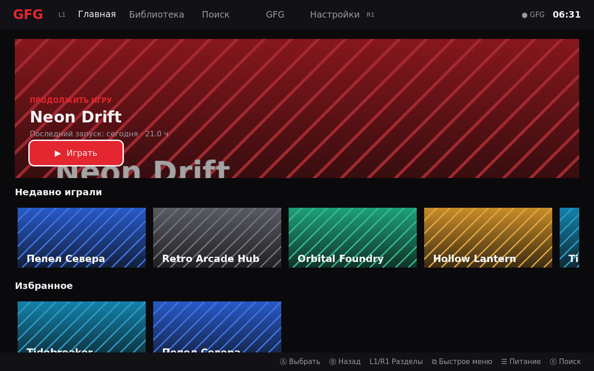
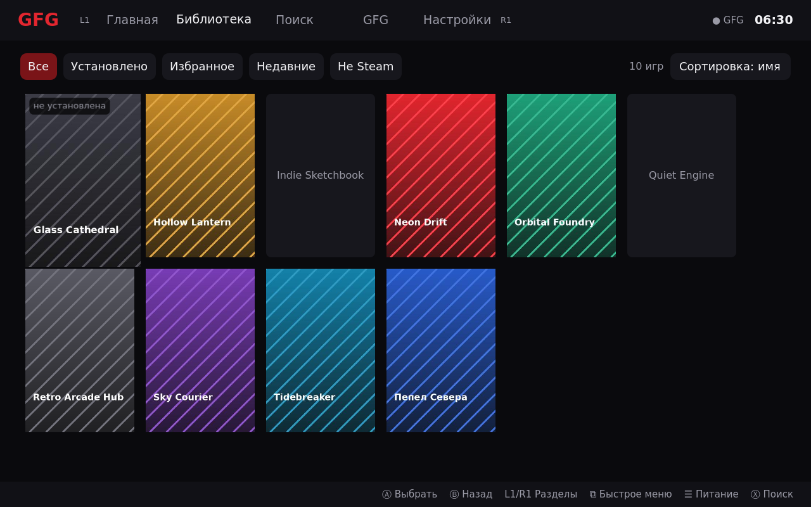
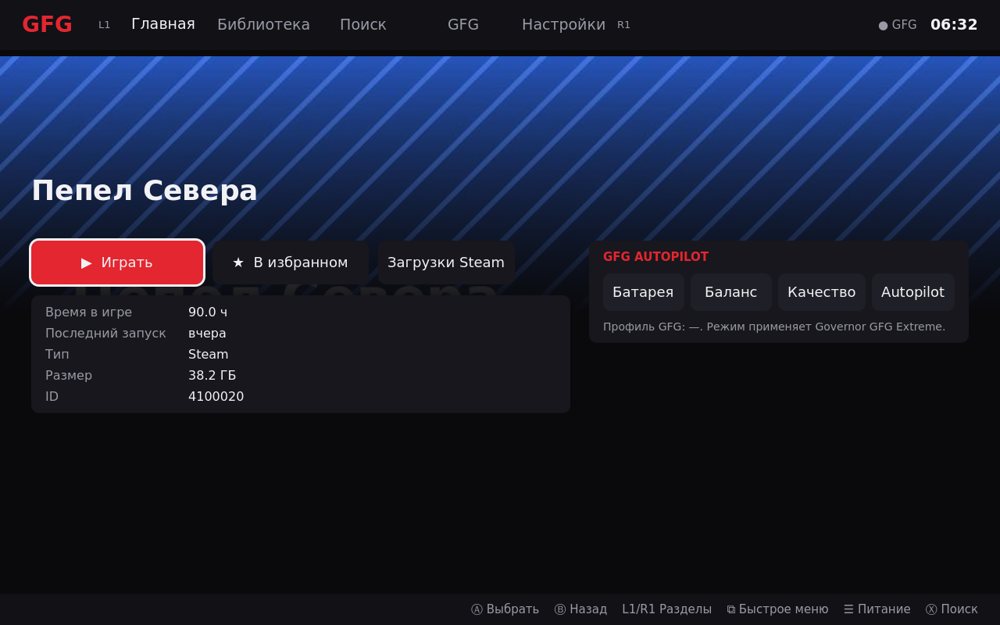
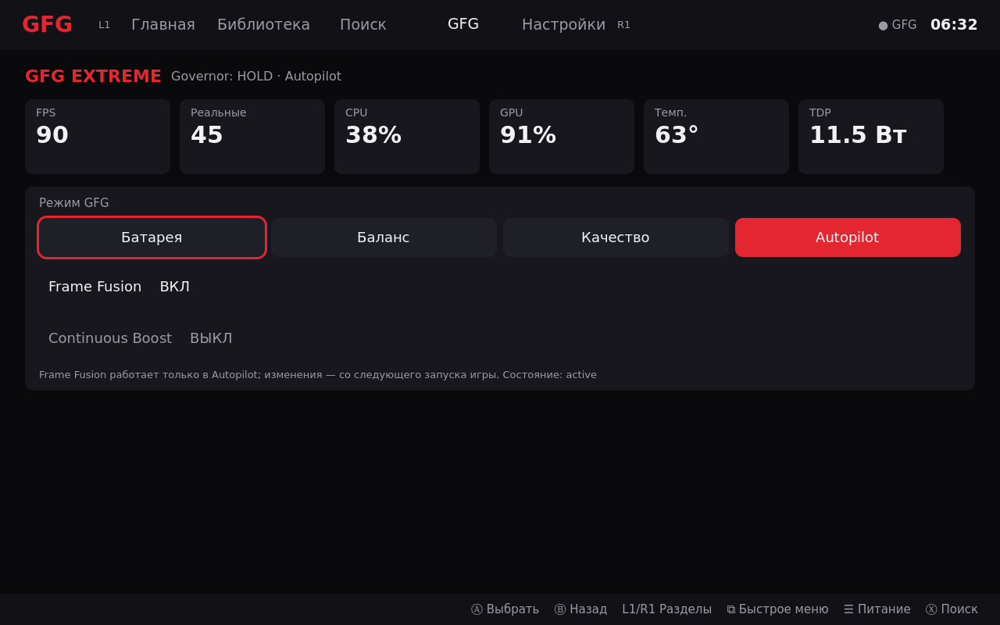
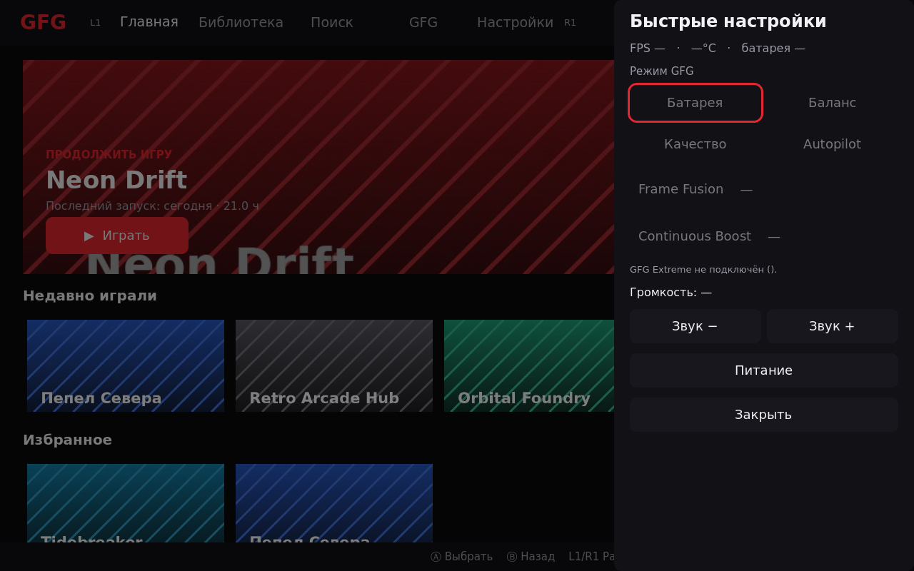
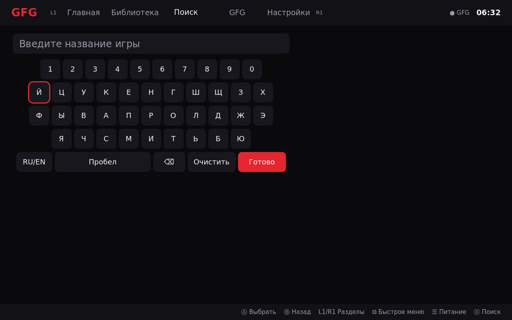
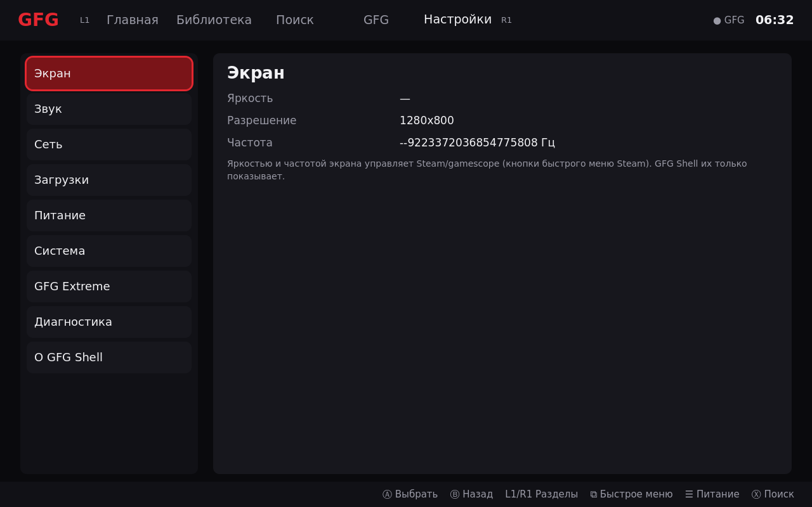
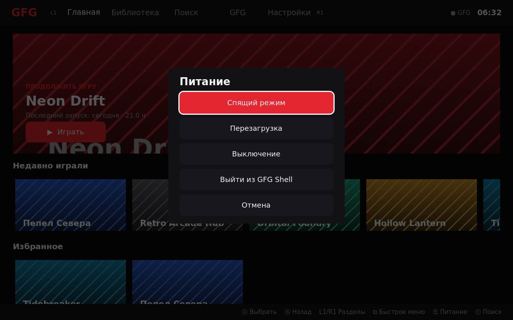

# GFG Shell

Контроллерная оболочка для Steam Deck OLED на Godot 4. Steam остаётся игровым клиентом
(авторизация, библиотека, загрузки, DRM, Steam Input, облако, запуск). Оболочка не является
темой CSS Loader и не внедряется в интерфейс Steam. Матрица возможностей и гипотезы —
[GFG_SHELL_RECON.md](GFG_SHELL_RECON.md).

## Состояние по этапам

| Этап | Что | Статус |
|---|---|---|
| A | Разведка, матрица возможностей | готово (документ) |
| B | Godot-оболочка: Главная, Библиотека (фильтры), Страница игры, Поиск с экранной клавиатурой, Недавние, Избранное, Настройки (Экран, Звук, Сеть, Загрузки, Питание, Система, GFG Extreme, Диагностика), меню питания, центр GFG, быстрая панель, экран запуска; запуск через Steam и возврат; работает как non-Steam игра | реализовано, проверено в CI/контейнере, **на Deck не проверено** |
| C | Собственная сессия Gaming Mode (overlay-модель, Steam постоянно запущен) | не начат, ждёт результатов H1–H8 |
| D | Быстрая панель поверх игры, маршрутизация ввода | не начат |
| E | GFG Bridge | ядро готово (сервер в плагине + клиент), расширение — после C |
| F | Надёжность, установщик, восстановление | основа: установка в `$HOME`, удаление, диагностика |

## Устройство

```
shell/                         Godot 4.4 проект (GDScript, GL Compatibility)
  scripts/core/
    vdf.gd                     текстовый и бинарный KeyValues (Valve)
    steam_library.gd           Steam Adapter: библиотека (только чтение файлов Steam)
    game_runner.gd             Steam Adapter: запуск через steam://rungameid, слежение по reaper SteamLaunch
    bridge_client.gd           клиент GFG Bridge
    system_info.gd             батарея/сеть/яркость (sysfs), звук (wpctl), питание (systemctl → logind)
    diagnostics.gd             zip диагностики на рабочий стол
    shell_state.gd             автозагрузка Shell: состояние, избранное, загрузка обложек в потоке
    log.gd                     журнал ~/.local/share/gfg-shell/logs
  scripts/ui, scripts/screens  интерфейс (тема по макетам: тёмный + красный)
  tests/run_tests.gd           headless-тесты (фикстура tools/make_fake_steam.py)
  tests/bridge_e2e.gd          Godot BridgeClient ↔ настоящий Python ShellBridge
  tools/package.sh             пакет: закреплённый Godot 4.4.1 (sha256) + .pck + скрипты
  package/                     install.sh / uninstall.sh / gfg-shell.sh / collect-diagnostics.sh
py_modules/gfg_plugin/shell_bridge.py   GFG Bridge в плагине GFG Extreme
```

### Правила, зашитые в код
- Игра запускается только Steam'ом (`steam steam://rungameid/<id>`; non-Steam — 64-битный id
  `(appid<<32)|0x02000000`). Оболочка никогда не завершает игру или Steam.
- Устройства ввода не захватываются; Steam Input не отключается. На этапе B оболочка получает
  виртуальный геймпад Steam Input, как любая игра. Кнопки Steam и «…» остаются у Steam.
- Пока идёт игра или окно не в фокусе, оболочка ограничивает себя 10 кадрами/с.
- TDP и частоты GPU выставляет только Governor. Bridge передаёт выбор режима
  (Батарея/Баланс/Качество/Autopilot — без Extreme, у него отдельное согласие), Frame Fusion и
  Continuous Boost в существующие методы Governor.
- Системный раздел SteamOS не меняется: всё ставится в `~/.local/share/gfg-shell`.

### GFG Bridge
TCP `127.0.0.1:<случайный порт>`, строки JSON. Порт и токен — в
`~/.local/state/gfg-extreme/shell-bridge.json` (права 0600, владелец — пользователь Deck).
Первый запрос соединения обязан содержать токен, иначе соединение закрывается.
Методы: `hello`, `status` (сжатый статус: режим, FPS реальные/выходные, температура, загрузка
CPU/GPU, TDP, батарея, Frame Fusion, Continuous Boost), `profiles`, `set_mode`,
`set_frame_fusion`, `set_feature` (только `continuous_boost`).

## Тест на Steam Deck (этап B)

1. Скачать `gfg-shell-<версия>.zip` из pre-release, в режиме рабочего стола: распаковать,
   `./install.sh` (если Steam запущен, оболочка появится в Steam как non-Steam игра; иначе
   добавить `~/.local/share/gfg-shell/app/gfg-shell.sh` вручную).
2. Вернуться в Gaming Mode, запустить «GFG Shell».
3. Пройти H1–H8 из [GFG_SHELL_RECON.md](GFG_SHELL_RECON.md#6-гипотезы-для-проверки-на-deck-этап-b):
   нативная игра, Proton-игра, non-Steam игра, игра с лаунчером, выход/падение игры,
   аварийное завершение оболочки, сон/пробуждение.
4. Настройки → Диагностика → «Собрать диагностику» и прислать zip
   (если оболочка не стартует — `~/.local/share/gfg-shell/app/collect-diagnostics.sh`).

Удаление: `~/.local/share/gfg-shell/app/uninstall.sh` и ярлык в Steam.

## Скриншоты

Сняты в CI-окружении (программный OpenGL, Xvfb, 1280×800) на вымышленной библиотеке
`shell/tools/make_fake_steam.py` и с настоящим сервером Bridge на поддельном Governor
(`shell/tools/fake_bridge.py`). Это не снимки с устройства.

| | |
|---|---|
|  |  |
|  |  |
|  |  |
|  |  |
