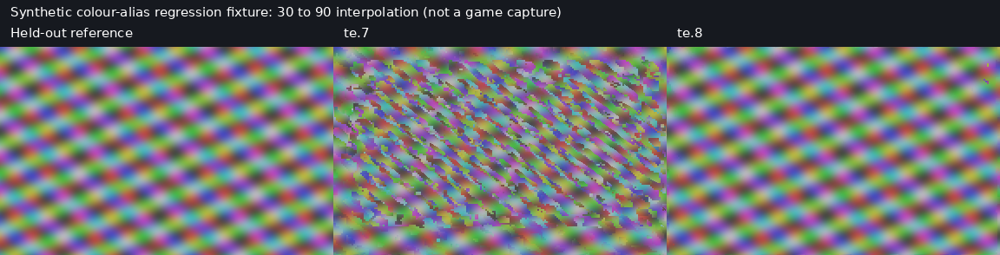

# Temporal Engine te.8: correctness and frame cost

This pre-release is based on `v2.1.2-te.7` (`a764fd1483ca81c909317256ab8c2b98ca266a35`). Its purpose is to fix generator failures and make its cost observable. Keeping a 90 FPS target is one part of that work, not evidence of delivering 90 frames per second.

## Confirmed defects addressed

- **An ostensibly bounded readiness call could block indefinitely.** `te_context_idle(timeout)` drained the LMC CPU worker before applying the Vulkan fence timeout. That worker could itself be waiting on the producer's GPU timeline. Readiness now uses one monotonic deadline across the worker and fences. A nonblocking submit also returns `VK_NOT_READY` rather than draining the worker. The regression test withholds a source, requests a 5 ms probe, releases the source after 150 ms, and verifies both timely failure and subsequent correct completion/signals. Teardown still requires the producer to release outstanding source work; this does not cancel Vulkan submissions or manufacture completion.
- **A cleanup fence could be counted as successful generation.** The worker now preserves an output-submission error. Collection refuses that failed work instead of reading unwritten queries and incrementing GPU-completed counters. The failure branch is reviewed/compiled; a real device-loss event was not injected in the local GPU tests.
- **Pure stage timing concealed pipeline gaps.** New cumulative timestamps measure analysis start to the first output and to the last output, including the CPU-fit/queue gap. CPU fit duration belongs to the ring slot that performed the work, rather than whichever global fit happened most recently. These are engine-ready timings, not physical display/input latency.
- **The overload guard ignored CPU/queue delays and depended on real FPS.** LMC now checks both GPU-stage share and whether the complete pair exceeds its observed real-frame interval. Sustained overload is counted in milliseconds (250 ms), not 30 pairs. Recovery uses sustained healthy time (10 s, with a 60 s guarded retry of a previously costly tier). At the cheapest tier, one pair may repeat before a fresh measurement; LMC no longer enters a 120-pair block of repeated frames. The separate legacy tile engine retains its own policy.
- **A one-pair hold disappeared from telemetry immediately.** `holding` now follows the submitted pair, rather than the already decremented count of future holds.
- **Luma aliases could produce unrelated long motion vectors on coloured repetitive textures.** Coarse search now uses four sparse chroma probes. A deadband leaves small illumination/reflection changes to the luma model; finest-level search remains unchanged. This avoids blindly applying a strong RGB term to reflective scenes.
- **Diagnostics showed the tile scheduler's 2 ms cap for LMC.** The panel and log report now distinguish the active LMC share budget from the tile cap, expose quality tier, CPU fit, first/all-output readiness and missed pair intervals, and retain these fields in recorded timelines.

## Reducing work without approximate model selection

The CPU fit constructs hypotheses lazily, rejects a hypothesis once its maximum possible inlier score cannot beat the winner, and stops when the first model already explains all scored points. Sparse normal-equation accumulation omits structurally zero products. The original candidate order, strict tie rule and IRLS refinement remain intact. `tools/benchmark_lmc_fit.py` checks complete output models against te.7 before reporting paired timings.

The half-resolution field shader stops searching a workgroup/block when its current error is at or below the lower bound of every remaining candidate (`P.margin`). This is a cost bound, not a relaxed matching threshold. Coarse search also avoids chroma probes for candidates that already lose on luma alone. Full-resolution composition checks endpoint bounds instead of treating clamped border texels as another visible surface.

## Validation and limits

Local validation uses Debian 13, Node 24, Python 3.12, GCC, pinned Vulkan headers and Mesa 25.0.7 lavapipe/llvmpipe (LLVM 19). Release CI uses its existing Ubuntu 22.04 / Node 22 / Python 3.13 / GCC 12 workflow. The local renderer build is validation output; the installable release must come from the supported release workflow, not the newer host libc build.

- Backend: 1258 tests, one skipped.
- Native engine: 168 checks, zero failures, Vulkan validation enabled.
- Native renderer: 50 CTest tests plus Fusion image/integration checks.
- Frontend: current committed build, 117 smoke-test screens.
- CPU fit: 96 full-grid model comparisons (camera translation, rotation, planes, outliers, noise, empty input), bit-identical in this test set. Coherent camera/plane fits took roughly 25–31% less host CPU time; the noise-only case regressed by about 6%. Neither figure is a Steam Deck FPS claim.
- Quality: seven analytic fixtures and separate Godot sword/walk/specular scenes at 1280x800, using held-out frames for 30→90 interpolation. See the raw JSON results alongside this document. The analytic thin-post fixture has a small quality regression; the correction is not a claim of improvement in every scene.

The external timeline-semaphore FD import path is unavailable on this lavapipe device. The refusal path and in-process timeline protocol were checked; full cross-device renderer generation still needs device validation. GPU timestamp durations on a CPU Vulkan implementation are not Deck GPU timings or energy measurements. Small differences on a short synthetic segment do not establish perceptual improvement in a complete game.

The renderer still interpolates between real frames; it cannot recover unknown occluded content or eliminate the real-frame interval needed for interpolation. With the current normal multiplier range, approximately 24 real FPS are needed for 90 output FPS. Experimental Autopilot keeps the supported display target (90 on the OLED configuration) and exposes a miss instead of silently changing that goal to 45. Display refresh, user power limits and thermal guards remain authoritative.

## Reproduce comparisons

Build te.7 from a separate source archive and te.8 with the same compiler, shader tools and Vulkan device; do not compare a debug build with a release build. No additional Git worktree is required.

```sh
python3 tools/benchmark_lmc_fit.py --baseline-ref v2.1.2-te.7 --out fit.json
python3 tools/benchmark_temporal_90.py \
  --baseline /path/to/te7/te-bench --candidate /path/to/te8/te-bench \
  --out analytic.json
python3 tools/benchmark_temporal_paired.py \
  --baseline /path/to/te7/te-bench --candidate /path/to/te8/te-bench \
  --frames-root /path/to/rendered-scenes --scenes sword,walk,specular \
  --repeats 3 --out paired.json
```

For the short independent 3D checks, render 31 frames per scene with the pinned Godot runtime, fixed 90 FPS and the existing bench scene project. The comparison discards the first 10 render warmup frames, feeds 19 frames (six real-frame pairs), and scores the 12 missing frames. Timing excludes the first two engine pairs. The paired runner alternates binary order and retains every run; its summary is the median of per-run aggregates, not a pooled p95. Longer scenes and real game captures are still required for broad quality claims.

On the Deck, install the ZIP, update the bundled engine, restart the game through the GFG launcher and record matched Off → Experimental → Off segments in the same scene. Keep target, mode, rendering scale, power settings and camera route fixed. Compare real/output FPS, frame-time tails, new ready/CPU metrics, tier changes, holds, temperature and measured power. Off means the usual generator, not disabling all frame generation. Do not infer battery gain from lower shader time alone.



## Recorded comparison (2026-10-15)

The three counterbalanced Godot runs used the same input frames and build settings for each binary. Medians of per-run GPU-stage aggregates changed by −9.1% (sword), −8.4% (walk), and −12.6% (specular); field-pass aggregates changed by −41.1%, −28.2%, and −37.3%. These are software Vulkan measurements, not portable GPU speedups. The corresponding mean FLIP changes were −0.31%, −0.23%, and +0.22% (lower is better).

The analytic regression fixtures reduced mean FLIP by 94.4% on the slow coloured pan, 21.7% on the fast pan, 85.1% on the blade, 68.1% on the moving highlight, and 89.2% on the HUD fixture. These large ratios describe deliberately difficult luma-alias cases; they are not expected gains for arbitrary game footage. The analytic thin-post case regressed by 3.1%. Its raw result is retained. Single-run timing outliers are also retained; use the counterbalanced runs for the host cost comparison.

Raw results: [CPU model parity/cost](temporal_bench_results/te8_fit.json), [all analytic fixtures](temporal_bench_results/te8_analytic_30to90.json), [three counterbalanced 3D runs](temporal_bench_results/te8_godot_paired_30to90.json).
