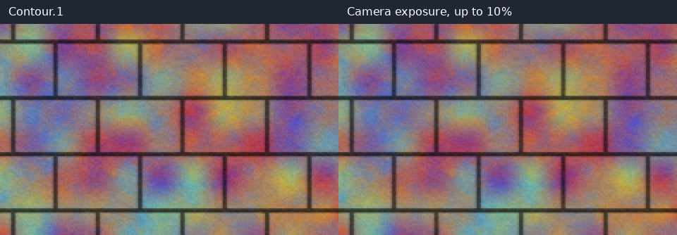

# Camera exposure test candidate

A confirmed fast SDR pan can add up to 10% of two symmetric samples along the measured camera displacement. A large disagreement with the projected previous frame or a better stationary match reduces the weight to zero. Both side samples come from the same new real frame. The previous frame only validates motion. The existing ring copy applies this before frame selection, so a displayed real frame and the synthetic phases built from it share the treatment.

The offset grows to at most two analysis pixels on either side. The first two source frames, slow or stationary motion, unsupported source intervals and HDR use the normal capture. Hard cuts and direction changes can take a pair to identify. The confidence test is per pixel and cannot identify every independent object or HUD. When a substantial part of the previous motion field has large residuals and the contour tracker detects a competing displacement, capture preserves the source for the contour warp.

Install the inner Decky ZIP for the plugin you use, reinstall the bundled Gamescope from Setup, then restart the Deck. Enable frame generation and compare a fast sideways pan past textured geometry, a sharp reversal and a static HUD. For rollback install the previous contour.1 ZIP and repeat the Gamescope reinstall and restart. Physical Steam Deck latency, frametime and visual preference remain unverified.

## See the change

[Slow-motion comparison](pan.mp4) of a synthetic noisy pan and a camera reversal. Each short sequence repeats twice and includes the real frame and both ×3 phases. The images use equal exposure and enlargement. The reference for measuring added grain is the clean render at the same instant.

## Replay from the installation package

The table compares the contour.1 capture shader with the turn.1 shader on identical synthetic inputs at 1280×800. Both runs used the Vulkan harness and all other shader binaries from the GFG test ZIP. Lower values are better in these columns. The block metric measures the share of severely inaccurate 4×4 blocks against the known intermediate render.

| Sequence | FG | Temporal error | Thin-line flicker | Severe blocks (%) |
|---|---|---:|---:|---:|
| Noisy pan | ×3 | 7.67 → 7.58 | 12.85 → 13.07 | 0.097 → 0.091 |
| Noisy pan | ×2 | 8.04 → 7.90 | 11.56 → 11.65 | 0.083 → 0.082 |
| Courtyard reversal | ×3 | 13.22 → 12.76 | 25.26 → 24.86 | 3.423 → 3.242 |
| Courtyard reversal | ×2 | 11.89 → 11.47 | 20.87 → 20.52 | 3.740 → 3.506 |
| Clean fast pan | ×3 | 5.28 → 5.34 | 10.72 → 10.90 | 0.395 → 0.388 |
| Clean fast pan | ×2 | 4.58 → 4.66 | 8.65 → 8.93 | 0.433 → 0.430 |
| Foreground fence | ×3 | 7.74 → 7.74 | 15.48 → 15.48 | 1.780 → 1.780 |
| Foreground fence | ×2 | 6.12 → 6.12 | 10.90 → 10.90 | 1.613 → 1.613 |

In the noisy pan the 10% mix also reduced the ×3 sharpness fluctuation index from 133.3 to 128.6. In a separate 480×300 replay the RMS luma noise in flat patches fell from 7.21 to 6.95 on real frames, from 5.09 to 4.97 on the first ×3 intermediate and from 4.63 to 4.54 on the second (8-bit luma units). These changes are small. The clean fast pan illustrates the downside for fine lines. The 15% prototype increased thin-line flicker further in the smaller noisy-pan trial. Applying blur only to synthetic frames also made sharpness alternate in some sequences. The selected variant uses up to 10% at source capture.

Vulkan capture timestamps on **llvmpipe (software), Mesa 25.0.7, four worker threads**, across the four package replays and both FG modes (56 timed captures per build, including bypass frames): median 3.56 → 9.60 ms, P95 5.28 → 14.42 ms. These software timings show an execution cost and cannot predict Steam Deck GPU time or input latency. The path adds no frame of buffering. A physical A/B should use the same game, save point, power profile and camera path, then compare missed presents and P95/P99 frametime at 30→60 and 30→90. End-to-end input latency needs a separate physical measurement.

To reproduce the table, unpack the GFG installer, use its `bench/kfg_vktest --hard --spv bench --size 1280x800 --scene SCENE --json results.json` with `KFG_HARD_X2=1 KFG_COURTYARD_TIMING=1`, and replay once per scene. For the control, copy the shader directory and replace only `kfg_copy.spv` with the Vulkan 1.1 SPIR-V compiled from Kedavra commit `38376ad7015fbf078b06df7d4abaadb8fe29f0d6`. The scene identifiers are `h_grain_pan`, `h_courtyard_reversal`, `h_turn64` and `h_parallax`.

## Verified packages

GitHub Actions downloads contain an outer archive. Extract it once and select the inner installation ZIP in Decky. Each package was unpacked and checked against its build manifest. The 72 shared runtime and test files matched between packages.

| Decky installer | SHA256 of the inner ZIP |
|---|---|
| [GFG Extreme 3.6.1-turn.1](https://github.com/wavessevaw/GFG-Extreme/actions/runs/45044635173/artifacts/14762388333) | `ee5913e79988ec867e676159dd8ae5a1a7fd73effbe231e20d1fdf47ddb17290` |
| [Standalone GSF Kedavra 1.8.1-turn.1](https://github.com/wavessevaw/GSF_Kedavra/actions/runs/45043796794/artifacts/14762584279) | `6dc5142f0206b62fa919ef2ebb0697c6d5b39cbd14b94e4e7fe60b6254d9dd7b` |

[GFG regression checks](https://github.com/wavessevaw/GFG-Extreme/actions/runs/45044635216) · [Kedavra build and tests](https://github.com/wavessevaw/GSF_Kedavra/actions/runs/45043796794).
