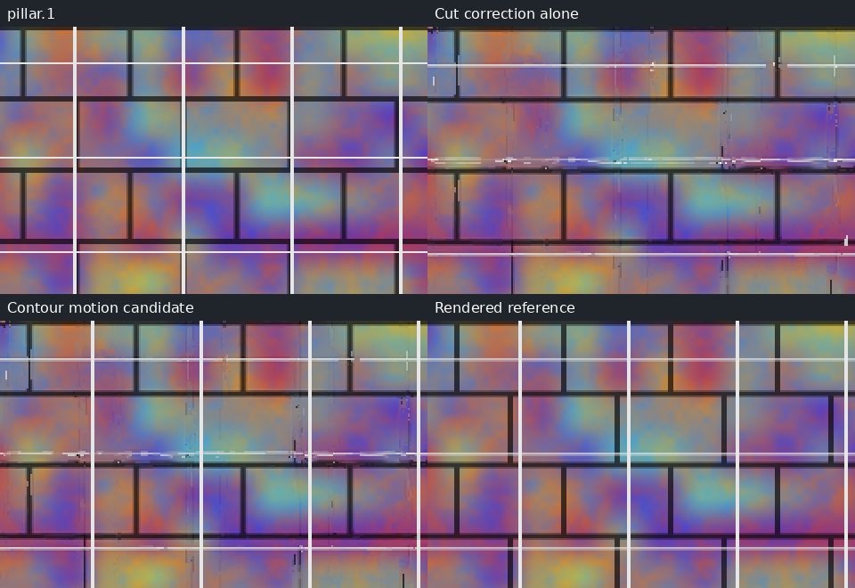

# Contour motion test candidate

During a pan, a thin foreground grille can move at a different speed from the scene visible through it. Kedavra measures the normal displacement of narrow, consistent contours from both real SDR frames. Sparse scanlines vote for the displacement and luminance ranges. The warp restores a contour only where the endpoints agree on its colour, orientation and profile. It removes a misplaced copy only when it can find the corresponding stroke in the opposite real frame. Competing or unsupported contours fall back to the existing warp. Diagonal, deforming and transparent silhouettes remain difficult.

The scene-cut check now reconsiders ambiguous scattered motion when motion compensation already explains most of the image difference. It requires matching textured landmarks across at least nine of sixteen screen regions. A confirmed cut continues to hold the older real frame. The stats texture grows by one RGBA16F texel per ring entry. The additional work uses the existing pair analysis and warp passes. No additional queued frame or control is needed.

Install only the ZIP for your current Decky plugin. Reinstall the bundled Gamescope from Setup and restart your Steam Deck. Enable frame generation. To roll back, install your previous package (GFG Extreme 3.6.0 or standalone Kedavra 1.8.0), reinstall Gamescope from its Setup menu and restart.

Test the same slow and fast pan past railings at 60 Hz ×2 and 90 Hz ×3. Compare on the same display, power limit and native cap. Also cross an opaque pillar, open a HUD, and trigger a real scene cut. Repeat the route with variable input below 30 FPS. Record missed presents, output frame time P95/P99, power and visible ghost trails for both packages. Desktop software Vulkan measurements do not establish handheld timing, energy use or game-specific quality.

## Comparison with pillar.1

All three columns use the same real input frames, the same rendered intermediate references and the executable extracted from the install package. The first uses the two archived pillar.1 shaders. The middle uses the candidate pair analysis with the pillar.1 warp. The third runs the packaged candidate shaders. The synthetic scene contains a near layer of foliage, a narrow bright fence, and a textured wall, travelling at three different speeds.



[Slow-motion comparison of all seven source intervals](parallax.mp4). Each triplet starts with a real frame followed by both ×3 phases. Playback is slowed to nine display frames per second to make the errors visible.

| 1280×800, seven intervals | pillar.1 | Cut correction alone | Contour motion |
|---|---:|---:|---:|
| Severe 4×4 tiles (%), ×2 | 17.00 | 4.04 | 1.61 |
| Outlying 8×8 tiles (%), ×2 | 6.29 | 12.15 | 10.60 |
| Temporal error, ×2 | 28.27 | 8.19 | 6.12 |
| Severe 4×4 tiles (%), ×3 | 17.19 | 3.82 | 1.78 |
| Outlying 8×8 tiles (%), ×3 | 4.68 | 11.56 | 10.06 |
| Temporal error, ×3 | 26.40 | 10.13 | 7.74 |
| False bright rail pixels, phase 1/2 | 237,081 | 4,569 | 1,987 |
| Missing bright rail pixels, phase 1/2 | 238,023 | 172,634 | 41,848 |
| False bright rail pixels, phase 1/3 | 236,679 | 5,468 | 2,879 |
| Missing bright rail pixels, phase 1/3 | 152,883 | 148,305 | 34,410 |
| False bright rail pixels, phase 2/3 | 236,989 | 5,472 | 2,968 |
| Missing bright rail pixels, phase 2/3 | 153,218 | 148,617 | 34,710 |

A severe tile has a mean absolute luma error above 48/255 against the true phase. The separate 8×8 metric measures a local outlier relative to the median error of its eight neighbours. This score is higher in the candidate than in the frequently frozen pillar.1 output. Local patches are still visible. The rail tests count bright pixels drawn on known darker background and missing pixels in bright reference rails. Both counts matter because simply erasing the fence can reduce false positives.

The packaged harness prints per-phase counts with `KFG_CONTOUR_METRICS=1 KFG_HARD_X2=1`. Raw counts in [scores.json](scores.json) are ordered as false bright pixels, eligible background pixels, missing rail pixels, eligible bright rail pixels. Regenerate the table with `kfg_vktest --spv SHADER_DIRECTORY --size 1280x800 --hard --scene h_parallax` for each of the three shader directories. Use this same binary for all runs. Restore the archived stats and warp shaders from commit `14c38882bbf52cd314a2ebeb46a83199d155c5e7` for the first directory and only the archived warp for the middle directory.

Checks also covered the reverse and vertical synthetic pans, hard cuts with shared textures and static HUD, the previous pillar crossing, and slow HUD strokes. In the earlier offline checks, the packaged algorithm showed no change to the reported full-frame scores on the irregular courtyard reversal and walking-actor crossing at 480×300. Three sampled windows per recording of OpenCV vtest, car and faceocc2 at ×2 and ×3 also showed no difference at the reported precision. No gameplay or physical LCD/OLED trace was available.

## Software Vulkan cost

Two alternating runs per configuration on Mesa llvmpipe, four threads, 1280×800. Each run generated 21 intermediate frames. Both variants use identical candidate pair analysis. The following timestamps isolate the warp dispatch when interpolation is active. Each row contains all 42 sampled warps after the quality runs warmed the cache.

| Warp duration in ms | Median | P95 | P99 |
|---|---:|---:|---:|
| cut-only | 42.47 | 50.78 | 52.85 |
| contour | 52.12 | 61.57 | 62.35 |

These are CPU software-driver timings. RADV warp time, Gamescope deadline misses, input latency and battery impact still require a Steam Deck.

[GFG Decky package](https://github.com/wavessevaw/GFG-Extreme/actions/runs/44985888571/artifacts/14739434279) · [standalone GSF Decky package](https://github.com/wavessevaw/GSF_Kedavra/actions/runs/44918541213/artifacts/14712796937). Each Actions download is an outer archive. Extract it once and install the named inner ZIP.

```text
61fa6d7acb32ca6c3a9037851eeb3800377c5a8bc17e180998220256416d1e2d  GFG-Extreme-v3_6_1-contour_1.zip
7ab90d84a042d90272bee515a8e4f6aaf5d96b9e470eea0cf8e5d7aa2f341b77  GSF-Kedavra-1.8.1-contour.1.zip
```
