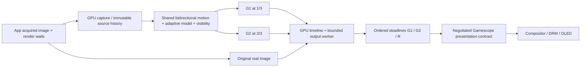

# GFG Frame Generator: Architecture Decision 1.0

Дата решения: 16.10.2026. Статус: **архитектура принята, реализация полного конвейера**.
Исследовательская фаза закрыта по последней P0 директиве владельца. Старые варианты,
провалы и raw measurements сохранены; новые сравнительные серии не запланированы.

## Единственная основная архитектура

**GPU-resident двухкадровая интерполяция с общим иерархическим анализом пары,
адаптивным уточнением движения и асинхронным выводом по отдельным deadlines.**
Вычислительный backend — GFG Shared Flow (GSF): bidirectional coarse-to-fine RGB
flow, дешёвый affine predictor и motion palette, dense visibility и ограниченный
orphan refinement. Если текущие совпадения плохо объясняются affine-моделью,
GPU выполняет полный projective fit. Это один адаптивный алгоритм с разной ценой
анализа, а не выбор пользователем между несколькими генераторами.

Продуктовая цель остаётся **30 настоящих → 90 отображаемых кадров на Steam Deck
OLED, SteamOS**. Обязательны разные временные выходы 1/3 и 2/3; дубликат или
recovery не считается выполненным ×3. Linux cloud/lavapipe используется для
проверки контрактов, а не вместо SteamOS и аппаратной приёмки.

## Почему это решение

| Подход | Вывод из накопленных данных | Решение |
|---|---|---|
| Плотный тяжёлый flow/solver на всей площади | Может дать полезные гипотезы, но обязательная цена каждой пары плохо соответствует APU | Не основной режим |
| Дешёвые блоки и компактная реконструкция | Реальный малый объект раздваивается, bolt теряет 2.207 dB | Исключён как основной reconstruct |
| Иерархический flow + локальное уточнение | Уже рабочие GPU kernels и история; большие перемещения ищутся на уменьшенных уровнях | Основа движения |
| История как замена анализа текущей пары | Не подтверждает движение после cut, пропуска, смены видимости | Только проверяемый predictor |
| Общий анализ + адаптивные motion hypotheses + точная локальная видимость | Palette оказалась полезной; полный projective fit нужен при несогласованном движении | **Выбрано** |
| Полная замена на FSR3 | Открытая математика полезна, но универсальный present hook не получает игровые depth/MV; исследованный presenter не готовый ×3 | Не заменяет текущую RGB-only систему |
| Подключение закрытого LSFG payload | Не даёт независимого генератора | Исключено |

LMC уже анализирует пару один раз. Это свойство нельзя выдавать за новое ускорение
GSF. Выигрыш ожидается от адаптивной цены анализа и устранения лишней работы;
доказательств универсального выигрыша на Deck пока нет. Выбранная architecture
не требует защищать названия LMC/GSF: backend отделён от capture/presenter.

## Полный путь кадра

1. **Capture.** Vulkan layer принимает фактический acquired image и render-finished
   semaphores. Их waits должны быть submitted до возврата из app Present.
   Capture копирует источник на GPU. Нет CPU pixel readback/upload в runtime.
   Настоящий кадр сохраняется; ошибка FG не разрешает повторно потребить app waits.
2. **History.** Два реальных изображения, pyramid предыдущего кадра, проверяемый
   temporal predictor. Gap, resize, discontinuity и cut разрывают соответствующую
   историю. Кадры источника неизменяемы во время анализа/реконструкции.
3. **Shared motion.** Поиск B→A и A→B coarse-to-fine до 1/16; доверие по текущей
   фотометрии. Один 64-lane workgroup строит affine candidate за три weighted LS
   итерации. Сохраняется палитра до четырёх доминирующих движений.
4. **Adaptive model.** Уже найденные текстурные совпадения проверяются относительно
   affine predictor. Если более половины usable blocks выходят за допуск
   `1.5 + 0.03*|v|` px, выполняется полный projective fit. Решение принимает GPU;
   oracle targets и CPU readback не используются. Неполезные model passes имеют
   uniform early-return. Отдельный telemetry flag фиксирует фактический fallback.
5. **Visibility.** Сохраняются dense half-res field, residual masks, bounded orphan
   queue и уточнение малых/независимых объектов. Их удаление провалило качество.
   Фотометрия проверяет model candidates; глобальная модель не считается истиной.
6. **FG3.** Анализ A общий: `cost_pair=A+S(1/3)+S(2/3)`. SELECT/COMPOSE зависят от t;
   маска видимости одного времени не переиспользуется как маска другого. Выходы
   имеют отдельные GPU completion values. Source кадр не перезаписывается.
   Текущий single-queue slice ставит оба compute output до transport copies;
   перед допуском G1 worker ждёт завершение пары и читает только control header.
   Cut/hold endpoints не получают synthetic credit. Это ограничивает раннюю
   доставку G1; отдельные GPU timestamps G1 не равны времени его WSI handoff.
7. **Async delivery.** Один executing job и один queued job; backpressure ограничен,
   бесконечной очереди нет. Worker владеет acquire/present и ожиданиями готовности.
   App ID/fence относятся к real, metadata копируются до возврата caller.
   Unknown metadata: drain и безопасный синхронный pass-through без pacing sleep.
   При недоступности worker GSF пропускает только real, без генерации и CPU waits.
8. **Deadlines.** При 90 Hz слоты идут через 11.111 ms. Clock резервирует один
   source interval lookahead; G1/G2/R имеют разные абсолютные сроки. Просроченная
   генерация пропускается, не отправляется догоняющей пачкой. Поздний source
   ресинхронизирует clock. CPU scheduling не доказывает время scanout.
9. **SteamOS output.** Нужен подтверждённый Gamescope контракт: lower MAILBOX может
   быть внутренним transport при compositor FIFO. Глобальная принудительная
   подмена MAILBOX на FIFO не выбрана. Текущий native vertical slice проверен на
   обычном FIFO; Gamescope future-deadline negotiation остаётся отдельным этапом.

Один будущий настоящий кадр означает около 33.333 ms lookahead при 30 FPS плюс
compute/readiness/display margin. Нулевая задержка не обещается. Асинхронный CPU
worker также не означает независимые GPU queues: текущий slice использует app
queue; contention с игрой и provisioning дополнительных RADV queues ещё не приняты.

## Сохранить, переработать, исключить

| Компонент | Действие |
|---|---|
| Собственные Vulkan loader/dispatch, borrowed-device, allocations, timeline, barriers, GPU queries | Сохранены, используются в runtime |
| LMC pyramids/search/history, palette, visibility/orphan, time-specific reconstruction | Сохранены там, где эксперименты подтвердили пользу |
| Обязательные три model fits каждой пары | Заменены дешёвым predictor и GPU confidence-triggered projective path |
| Native GPU capture, immutable metadata, bounded worker, lifecycle drain | Сохранены; GSF подключён к этому полному пути |
| Pacing только через доступность swapchain image | Заменён отдельными G1/G2/R host deadlines и readiness budget |
| CPU pixel bridge, host-signalled relay, compact-only reconstruction, закрытый DLL payload | Не входят в выбранную архитектуру |
| MAKO 4.5.0 GPL-3.0-or-later transport/presentation policies | Выбран открытый reference для Gamescope negotiation/deadline stage; не утверждается, что его transport уже перенесён |
| AMD MIT Vulkan presenter / optical flow source | Источник проверенных ownership/visibility контрактов; целиком не встраивается как готовый ×3 |

Точные версии, лицензии и границы открытого кода находятся в
[REFERENCE_REIMPLEMENTATION.md](REFERENCE_REIMPLEMENTATION.md).
Новый pipeline не требует Lossless.dll, закрытых weights или игровых depth/MV.

## Реализация и критерии этапов

| Этап | Реально реализовано | Подтверждено / гипотеза | Устранённый барьер |
|---|---|---|---|
| 1. Shared GPU backend | GSF с двумя временными выходами и adaptive projective path | 182 core checks; fast-turn probe вернул quality delta с −0.426 до около −0.002 dB; это не game/Deck acceptance | Backend перестал быть набором непроверенных shaders |
| 2. Native vertical slice | App GPU capture → borrowed-device GSF → G1/G2/R → lower WSI, launcher `run_gfg_gsf.sh` | Borrowed device pixels/lifetime и независимый WSI pixel observer; software only | GSF больше не существует только в offline benchmark |
| 3. Output ownership/clock | Bounded worker, отдельные deadlines, GPU-ready budget, deadline drops, skip accounting, lifecycle drains | Functional software tests; бюджет 90 Hz на lavapipe провален, не скрыт уменьшением заявленной цели | Пачечная отправка выходов и отсутствие отдельного времени каждого output |
| 4. SteamOS presentation | Следующий инженерный этап: интегрировать подтверждённый Gamescope timing/WSI contract | Нужны реальный compositor path и аппаратный trace | Устранить отказ нижнего MAILBOX и подтвердить compositor delivery |
| 5. HDR и resource budget | Явный linear/PQ color path; GPU queue/power budget с игрой | FP16 static roundtrip уже есть; dynamic PQ quality и RADV contention ещё не подтверждены | Устранить неверную цветовую интерполяцию и потери настоящих FPS |
| 6. Аппаратная приёмка | Связать R/G1/G2 с Gamescope commit и DRM flip, при возможности optical verification | Без доступа к Deck не выполнена | Доказать именно 30 real → 90 distinct displayed, cadence и latency |

Прежний экспериментальный gate «15% быстрее на каждой сцене без quality regression»
не пройден. Его результат сохранён. Последняя P0 директива требует продолжить
полный конвейер до идеальной производительности, поэтому он не блокирует opt-in
инженерную интеграцию. Это не разрешение объявить release или аппаратную цель выполненной.

## Уверенность, риски и условия пересмотра

- **Высокая уверенность** в разделении GPU backend / bounded transport / deadline
  presenter и в общем анализе пары: эти контракты реализованы и проверяемы.
- **Умеренная уверенность** в выбранном adaptive flow/model balance: компактные
  упрощения отклонены, нужные fallback возвращены. Универсального превосходства
  над LMC нет; абсолютное качество быстрых поворотов пока низкое у обоих.
- **Низкая уверенность в численном Deck budget до испытаний.** Software spans
  не переносимы на RADV, power, input latency или физические 90 Hz.

Пересмотр backend потребуется, если после интеграции аппаратный p95/contended cost
не оставляет бюджет настоящим 30 FPS или RGB-only visibility систематически даёт
неприемлемые ошибки. Пересмотр presenter потребуется, если подтверждённый Gamescope
contract нельзя обеспечить на app hook: тогда открытый MAKO host используется
как transport для того же независимого backend. Это заранее определённые условия,
не повод сейчас запускать очередное сравнение технологий.

Остаются реальные препятствия: Gamescope MAILBOX/timing topology, HDR transfer
function, неполный cut detector, и отсутствие подключённого Deck/DRM/optical trace.
Последний renderer cut был пропущен эвристикой; noise-cut test не скрывает этот факт.
В cloud отсутствует `/dev/dri`, ICD — llvmpipe. Продуктовая приёмка **не выполнена**.

Полные отрицательные результаты и протокол:
[SHARED_FLOW_PROTOTYPE.md](SHARED_FLOW_PROTOTYPE.md),
[архив закрытых экспериментов](evidence/gsf-research-20261016.zip).
