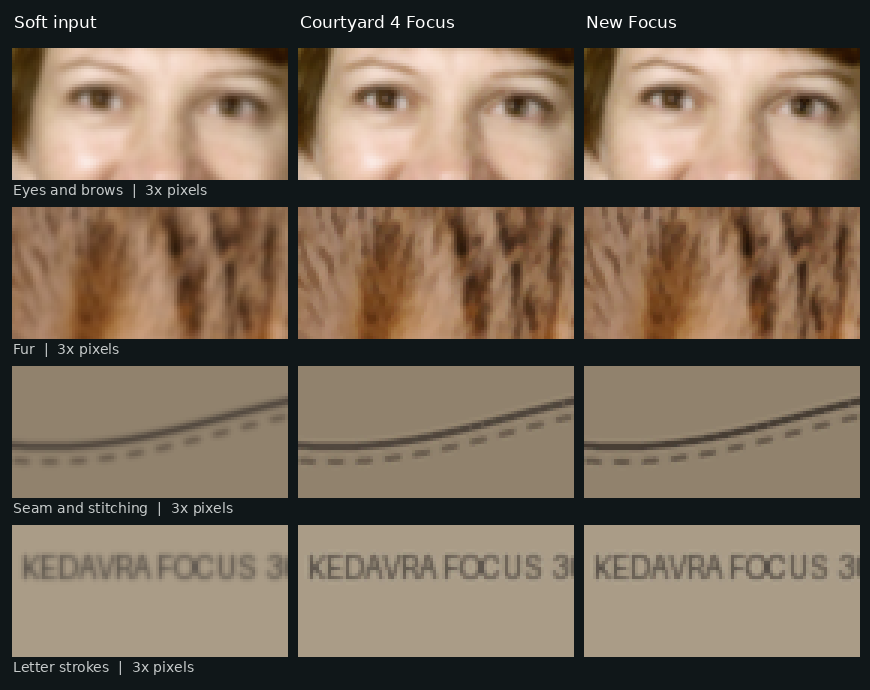

# Dark detail in Kedavra Focus

This GFG Extreme 3.5.0 test package includes Courtyard 4 and Kedavra 4c496fa. Use the existing **Graphics → Kedavra Focus** switch in SDR. The switch still runs at full strength. The new part of Focus adds a small amount of darkness to softened strokes with brighter pixels on both sides. Surrounding pixels retain the previous Focus output. The shader uses the original 3×3 region to estimate curvature along and across the stroke. Two conditional samples check its flanks. It runs in the existing pass on real and generated display frames. No temporal history or upscaler identification is involved.

## Examples

The columns below show the soft input, Courtyard 4 Focus and this candidate on identical crops. The images use nearest-neighbour enlargement with identical exposure and colour. The two photo inputs have a 1 px Gaussian blur. The curves and stitches are procedurally drawn. The NASA portrait of Eileen Collins is public domain. Chelsea is by Stefan van der Walt (CC0), distributed by scikit-image.

[Alternate between both versions in the same position (lossless WebP)](same-position.webp) · [Watch matched real and intermediate phases in the Courtyard 4 synthetic scene (MP4)](courtyard.mp4)

## Measurements

On a soft grey stroke with background 151/255, four angles and 16 subpixel phases, the peak luminance deficit averaged 54.25–57.93 codes with Courtyard 4 and 63.63–66.00 with the candidate. The half-depth width decreased by 0.14–0.18 px. A black line, flat field, broad shadow, isolated dot, hard step and pre-ringing control matched the previous Focus output. The additional one-sided correction produced no brighter pixels in the test set. A noise sample changed by 0.006 code on average. The dark excursion limit is 14 codes below the input 3×3 minimum. The original 7-code bright excursion limit still applies.

Mean absolute luminance error relative to the original photograph fell from 3.72 to 3.67 on the softened portrait and from 4.66 to 4.59 on softened fur. It increased on the native inputs, from 2.58 to 2.72 and 4.73 to 4.93 respectively. The RMS of the change in error between consecutive frames of the synthetic ×3 crop rose from 18.44 to 18.66 codes. The filter cannot distinguish every generated artifact from a genuine dark stroke.

For 24 warmed 1280×800 software Vulkan dispatches per version in A–B–B–A order, the respective medians were 17.94 and 21.31 ms and P95 values were 22.87 and 36.03 ms. Those times are for llvmpipe. Actual Steam Deck GPU time, frame pacing and perceived quality in games need device testing.

[Image and motion measurements](results.json) · [Individual software timestamps](software-timing.json)

## Install and roll back

Extract the GitHub Actions download once. Install the inner GFG ZIP in Decky, reinstall Gamescope in GFG Setup and restart the Deck. Check for runtime **kedavra-1.7.0-4c496fa**. In SDR, compare the same scene with Focus off and on. Look at stitches, eyelashes and dark lettering, then repeat while panning. Compare results with Courtyard 4 at the same native FPS, refresh rate, filters and power limit. For rollback, install the Courtyard 4 or official 3.5.0 ZIP, reinstall its Gamescope in Setup and restart.

The script kedavra/tools/detail/dark_strokes.py in GSF runs the paired dispatches. Supply --exe (kfg_detailtest), --base and --candidate (SPIR-V directories), --out, and optionally --photos (the pinned detail references) and --fg (the Courtyard 4 h_courtyard_reversal ×3 PPM sequence).
