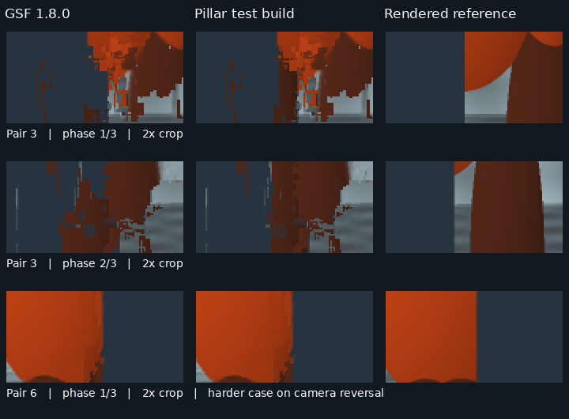

# Pillar crossing test build

GFG Extreme 3.6.1-pillar.1 includes the matching GSF Kedavra 1.8.1-pillar.1 Gamescope. This experimental SDR change targets a retained piece of a near opaque object when a character passes behind it. The warp locates the same material edge in the two real inputs, estimates when that edge moves past a pixel and samples the endpoint where the other surface is visible. No new dispatch, output-sized image or source frame is needed.

## Native-resolution comparison

The screenshots show enlarged crops from identical 1280×800 inputs at two intermediate phases of the same source pair, followed by a harder case. The last column is rendered independently at the exact phase. The animation covers every real and generated frame of the forward ×3 sequence at one sixth speed.

[Play the lossless motion comparison](crossing.webp)

## Measured behaviour

Each run uses eight source frames. The comparison uses all seven intervals and both playback orders. Source intervals varied from 26 to 57 ms in the irregular run and alternated between 33 and 34 ms in the steady run. Source and reference pixel hashes matched between engines. Only final RGB reached the interpolation engine. Tests ran on Mesa llvmpipe.

The scored region contains pixels where the real endpoints disagree about column coverage and the reference contains the character. Counts are exact matches to the opaque column colour. RGB MAE measures the actual reconstruction on the entire region, on a 0–255 scale. Lower values are better for both.

| Cadence / direction | Phase | Pixels | Column pixels, 1.8.0 → test | RGB MAE, 1.8.0 → test |
|---|---:|---:|---:|---:|
| Irregular forward | 1/2 | 23,067 | 2,112 → 487 | 20.59 → 19.43 |
| Irregular forward | 1/3 | 16,248 | 1,002 → 221 | 19.93 → 19.68 |
| Irregular forward | 2/3 | 30,011 | 1,456 → 266 | 16.52 → 15.73 |
| Irregular reverse | 1/2 | 23,067 | 733 → 253 | 21.48 → 21.72 |
| Irregular reverse | 1/3 | 30,011 | 817 → 196 | 17.27 → 17.03 |
| Irregular reverse | 2/3 | 16,248 | 274 → 57 | 21.58 → 21.88 |
| Steady forward | 1/2 | 22,203 | 1,412 → 909 | 17.27 → 17.26 |
| Steady forward | 1/3 | 16,467 | 824 → 644 | 19.02 → 18.92 |
| Steady forward | 2/3 | 26,885 | 1,050 → 464 | 14.38 → 14.06 |
| Steady reverse | 1/2 | 22,203 | 1,305 → 601 | 16.49 → 17.05 |
| Steady reverse | 1/3 | 26,885 | 660 → 274 | 13.26 → 13.31 |
| Steady reverse | 2/3 | 16,467 | 870 → 499 | 18.32 → 18.81 |

Allowing up to four 8-bit levels per channel from the column colour, the irregular forward counts fell from 2,719 to 1,000 at ×2, from 1,360 to 433 at ×3 phase 1/3 and from 1,888 to 550 at phase 2/3. The narrower artifact recedes in both directions. The recovered colour can still be wrong near an arm, leg or busy background. Several backward phases show higher RGB error despite fewer retained column pixels.

The 480×300 hold-outs use the existing hard suite. Δ values are test minus 1.8.0. PSNR is higher-is-better and temporal error is lower-is-better.

| Scene | Δ PSNR ×2 / ×3 (dB) | Δ temporal error ×2 / ×3 |
|---|---:|---:|
| h_courtyard_reversal | +0.000 / -0.008 | +0.001 / +0.007 |
| h_turn64 | +0.000 / +0.000 | +0.001 / +0.001 |
| h_lines_slow | +0.004 / +0.008 | +0.001 / +0.003 |
| h_lines_fast | -0.068 / -0.054 | +0.046 / +0.047 |
| h_parallax | +0.000 / +0.000 | +0.000 / +0.000 |

The largest hold-out loss is fast thin lines. Baseline optical flow, Focus, HDR transfer functions and the 60/90 Hz scheduler are used as in the stable package. Hardware GPU time, presentation timing, battery use, controller latency and gameplay behaviour remain unverified.

## Installation and rollback

Extract the GitHub Actions download once. Install the inner GFG plugin ZIP in Decky, open Setup, reinstall the bundled Gamescope, then restart the Deck. Choose ×2 at 60 Hz or ×3 at 90 Hz and repeat the same camera turn past a post with an NPC. The correction runs during frame generation in SDR. Focus is independent.

To roll back, install [GFG Extreme 3.6.0](https://github.com/wavessevaw/GFG-Extreme/releases/tag/v3.6.0), reinstall its Gamescope in Setup, then restart. The separate [engine source and reproduction instructions](https://github.com/wavessevaw/GSF_Kedavra/tree/14c38882bbf52cd314a2ebeb46a83199d155c5e7/docs/pillar-crossing) cover standalone Kedavra.

## Selection

Matching the colour of the endpoints over a larger patch improved column edges while misplacing parts of the character. Extending luma selection with chroma helped one direction but increased revealed-character error in the forward ×3 early phase. Looking only at global camera motion left 1,002 opaque pixels on the character in that phase at native resolution. The selected warp brackets the material boundary in each endpoint and can search the opposite direction when the camera estimate points the wrong way. A stricter donor-agreement variant reduced some reverse-playback errors but recovered less of the character during forward motion.

GPU cost depends on how often endpoint colours disagree and match the generated result. An ambiguous pixel can inspect two directions, with a bounded search up to 127 pixels per endpoint. Re-run the linked scenario with Vulkan timestamps on the target device and compare gameplay input-to-display latency before considering promotion.
