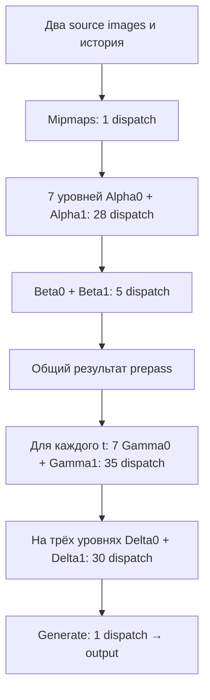

# Наблюдаемый host-side граф LSFG в MAKO

SOURCE VERIFIED, для двух зафиксированных MAKO SHA. Это граф исполнения MAKO, а не подтверждённая D3D-трасса оригинального Lossless Scaling. Названия alpha/beta/gamma/delta сохранены: их математическое назначение без исследования shader bodies не восстановлено.

SOURCE VERIFIED: prepass `1 + 7×(3+1) + 1+4 = 34`; каждый синтетический выход `7×(1+4) + 3×(2+8) + 1 = 66`. SDR без HDR-конверсий и специальных warmup/history paths. [Вызовы prepass](https://github.com/eugeniosegala/MAKO/blob/edd2946bd3c4281e357bd436e0e7b80df0759576/engine/mako-backend/src/mako.cpp#L869), [цикл outputs](https://github.com/eugeniosegala/MAKO/blob/edd2946bd3c4281e357bd436e0e7b80df0759576/engine/mako-backend/src/mako.cpp#L907). Количество вызовов внутри цепочек и контрольные суммы — [inventory](results/source_inventory.json).

| Выходной множитель | Синтетических N | Dispatch, модель SDR |
| --- | --- | --- |
| 2× | 1 | 100 |
| 3× | 2 | 166 |
| 5× | 4 | 298 |

SOURCE VERIFIED: общий prepass повторно используется всеми выходами; timestamp-specific gamma/delta/generate повторяются. Это точнее гипотезы «полный optical flow заново для каждого выхода» и точнее гипотезы «на каждый выход только дешёвый blend».

NOT TESTED: сколько именно этих операций является optical flow/confidence/occlusion, реальные memory reads, occupancy, стоимость на RDNA 2, соответствие графу оригинальной Windows-версии. Dispatch count не ранжирует производительность разных алгоритмов.
