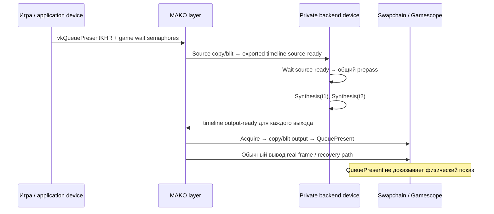

# Жизненный цикл изображения

SOURCE VERIFIED: схема отражает открытый MAKO code path, не GPU-трассу или оптическое измерение.

SOURCE VERIFIED: [source copy](https://github.com/eugeniosegala/MAKO/blob/e933b42fcdf2768c34aa5e921aa6b76da03304c0/engine/mako-render/src/swapchain/present/real_frames.cpp#L277), [generated output](https://github.com/eugeniosegala/MAKO/blob/e933b42fcdf2768c34aa5e921aa6b76da03304c0/engine/mako-render/src/swapchain/present/generated_frames.cpp#L364), [backend phases](https://github.com/eugeniosegala/MAKO/blob/edd2946bd3c4281e357bd436e0e7b80df0759576/engine/mako-backend/src/mako.cpp#L869). Фактический порядок относительно source images требует учитывать накопленную историю и admission plan, а не только подписи A/B.

SOURCE VERIFIED: для backend начальный timeline idx ждёт source-ready; prepass сигналит private semaphore со старым idx и увеличивает idx; выход i ждёт prepass idx−1, сигналит общий timeline idx+i. После N выходов idx сдвигается на N, temporal frame index увеличивается. Не переиспользовать память при одном лишь успехе CPU submit.

NOT TESTED: фактическое отображение каждого output, scanout latency и оптический cadence на Steam Deck. Dropped output, повтор исходного изображения и непринятый план должны оставаться отдельными счётчиками.
